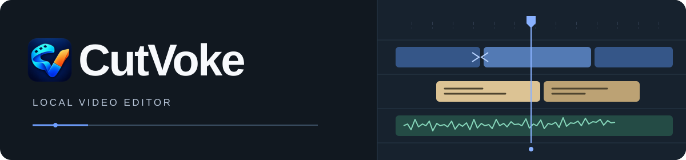
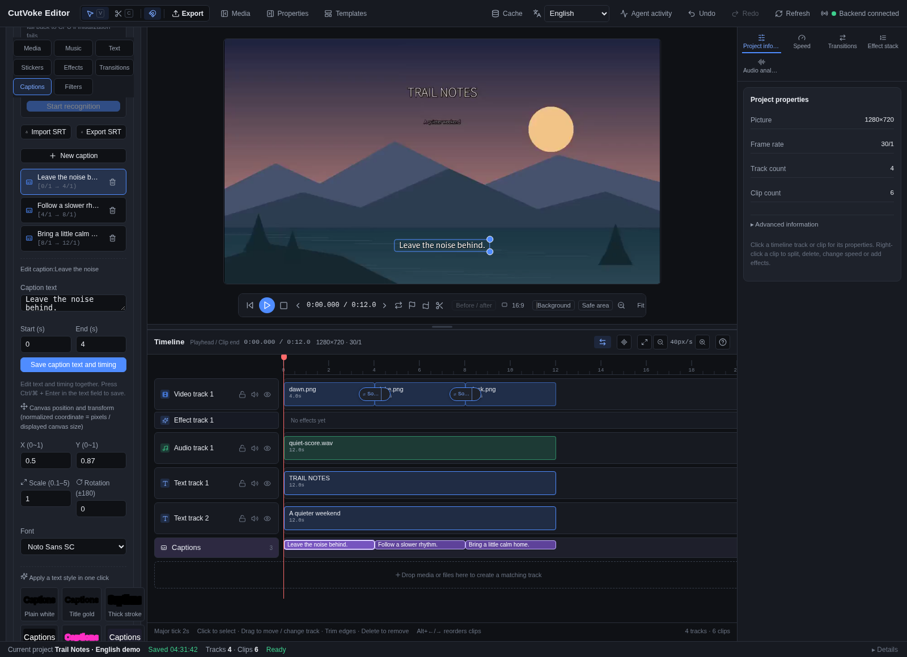
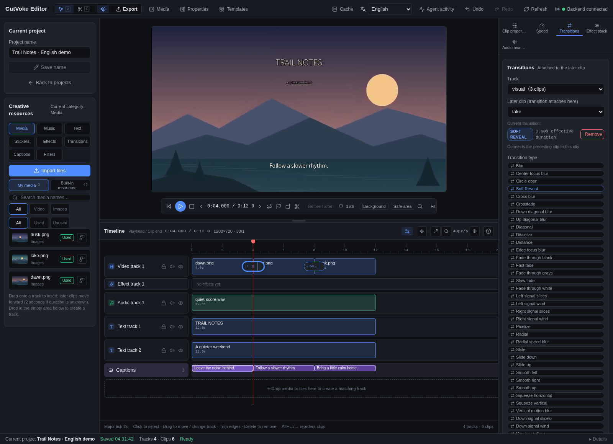

<div align="center">



# CutVoke — Open-Source AI Video Editor for Humans and AI Agents

**Your Footage. Your AI. One Shared, Editable Timeline.**

*An open-source, local-first AI video editor with a built-in MCP server: Claude Code, Codex, Cursor or any MCP client can cut, caption and add effects, and you finish the edit by hand on the same non-destructive, multi-track timeline. Desktop app for Windows, macOS and Linux.*

[](https://github.com/frankShan001/CutVoke/releases/tag/v0.3.6)
[](LICENSE)
[](pyproject.toml)
[](docs/user/LOCAL_DELIVERY_MCP.md)
[](https://glama.ai/mcp/servers/frankShan001/CutVoke)
[](https://ffmpeg.org/)

[**English**](README.md) | [**简体中文**](README.zh-CN.md)

[Download Desktop App](https://github.com/frankShan001/CutVoke/releases/tag/v0.3.6) · [What's New in v0.3.6](https://github.com/frankShan001/CutVoke/releases/tag/v0.3.6) · [Watch Showcases](examples/showcases/) · [Connect AI Agents](docs/user/LOCAL_DELIVERY_MCP.md) · [Contribute Effects](CONTRIBUTING.md) · [Save your own effect preset](effects/README.md#create-while-editing-no-development-setup) · [FAQ](#faq)

</div>

<p align="center">
  
</p>

> **CutVoke is an open-source, local video editor your AI agent can drive over MCP — and you can open the same timeline and fix anything by hand.**
> CutVoke runs on **Windows · macOS · Linux**, needs no account for local editing, and its source is MIT-licensed. Choose your own AI agent; external AI services may have separate accounts, costs and data policies.
> Works with Claude Code, Codex, Cursor, Claude Desktop, or any MCP client.
> Looking for an open-source CapCut alternative that an AI agent can also drive, or an MCP server for video editing? That is what CutVoke is built for.

**Connect your agent in 30 seconds**

1. [Download CutVoke v0.3.6](https://github.com/frankShan001/CutVoke/releases/tag/v0.3.6) and launch it once.
2. Open `profile/mcp-config.json` in the CutVoke data folder (Windows portable: `CutVoke Data` next to the exe · macOS: `~/Library/Application Support/CutVoke/` · Linux: `${XDG_DATA_HOME:-~/.local/share}/CutVoke/`). It already contains the bundled engine command, so no Python install is needed.
3. Add the `cutvoke` entry to your agent: [Claude Code](docs/integrations/claude-code.md) · [Codex](docs/integrations/codex.md) · [Cursor](docs/integrations/cursor.md). Then ask: *"Cut the silences, add captions, make a 9:16 version, and show me a few frames before you export."*

⭐ **If CutVoke is useful to you, a star helps other creators find it.**

## What's New in v0.3.6 Preview

- **More Reliable Media Handling**: Transparent VP8/VP9 WebM compositing, corrupt thumbnail/waveform cache rebuilding, short-audio export tails, and export-path editing fixes.
- **Safer Human + Agent Collaboration**: Explicit editing takeover, lease revision review, local audio inspection, and editable generated-source handoffs.
- **Editing Reliability Improvements**: Native audition startup, stale keyframe selection, and cancellation handling improvements. Some intermittent playback issues remain under investigation.
- **Four Download Targets**: Windows x64, Linux x64, macOS Apple Silicon and Intel. See the [release notes and verified downloads](https://github.com/frankShan001/CutVoke/releases/tag/v0.3.6).

> **Download vs. source:** v0.3.6 is a frozen preview, not current `main`. Later project-format migration and thumbnail-seeking changes are **not included**. Source `main` now identifies older projects and offers **Convert copy and open** or **Close**, preserving the original. Use the [v0.3.6 source tree](https://github.com/frankShan001/CutVoke/tree/v0.3.6) for documentation matching the download; unlabelled repository documentation follows `main`.

### Before You Update

Close CutVoke and back up your projects and media. Keep the previous app available until your own projects have been checked.

- **Export-window reuse is disabled in all four v0.3.6 packages.** Normal export works, but retrying does not resume completed windows. This is separate from the code-video generation cache.
- Intermittent audition/keyboard timeouts and manual keyframe misalignment after split/left trim are not fully resolved. Long portrait captions have clipped in Linux export tests; other platforms and preview parity are not yet verified. Inspect these cases before final delivery.
- Packaged-app and offline MCPB checks passed, but do not establish real-client installation, cross-version migration, physical-device behavior or first launch after quarantine. macOS packages are ad-hoc signed, **not Developer ID signed or notarized**. See the [full release limitations](https://github.com/frankShan001/CutVoke/releases/tag/v0.3.6).

## Watch Product Overview

<p>
  <a href="https://www.bilibili.com/video/BV18VHA62EZ1/"></a>
  &nbsp;
  <a href="https://www.youtube.com/watch?v=2--4_XO15RI"></a>
</p>

## Why CutVoke?

Most AI video tools give you a "take-it-or-leave-it" exported MP4—if one cut feels off or a caption is misspelled, you have to re-roll the prompt or start over in a traditional editor. Meanwhile, traditional NLEs require tedious manual slicing, keyframing, and caption alignment.

**CutVoke bridges both worlds.** AI agents and human editors work on the **exact same declarative timeline**:

| Pain Point | Traditional Video Editors | Black-Box AI Video Generators | CutVoke (Human + AI Shared Timeline) |
| :--- | :--- | :--- | :--- |
| **Rough Cuts & Assembly** | Manual scrubbing, slicing, and track sorting | Fast generation, zero timeline control | AI agent builds the multi-track rough cut; you tweak any frame visually |
| **Iteration & Fine-Tuning** | Full manual control, high time cost | Re-prompt and hope for a better output | Edit by transcript, drag clips, adjust keyframes, or ask AI to patch specific tracks |
| **Captions & Audio Sync** | Manual alignment or cloud paywalls | Burned-in text that cannot be edited | Local ASR auto-captions on editable subtitle tracks with full styling control |
| **Transitions & VFX** | Complex node graphs or proprietary plugins | Unpredictable visual artifacts | Parameterized, inspectable community effect recipes ([`effects/`](effects/)) |
| **Privacy & Cost** | Heavy hardware or subscription lock-in | Cloud uploads & per-minute credit fees | **100% Local-First** powered by your local FFmpeg pipeline—zero cloud fees |

<div align="center">
  
</div>

| Editable Captions & Transcript Cutting | Reusable Community Transitions & VFX |
| :---: | :---: |
|  |  |
| Generate, split, cut by word/sentence, and restyle subtitles on a dedicated track | Apply parameterized transition recipes across any cut boundary |

## Two Complete Editing Showcases

See the raw clips first, then the finished edit. Both showcases provide **bilingual videos, raw source footage, and editable `.cutvokepack` project packages**. Play the videos below with audio, or download the MP4s.

### 01 · Chase the Light

**Motorcycle Short Film · 31.6s · Landscape**

https://github.com/user-attachments/assets/3504df36-059c-4ca5-ade9-dbde6a0e1663

[Download Comparison Video with Audio (EN)](https://raw.gitcode.com/shansjl/CutVoke/blobs/be0897f4fed7fe6869d188c7e54bbfad1e19afcd/examples/showcases/chase-the-light/videos/motorcycle-case_en.mp4) · [Open Repo Video Page](examples/showcases/chase-the-light/videos/motorcycle-case_en.mp4)

**What to look for:** Moving masks, fragment reconstruction, light-anchor tracking, multi-layer lighting, and kinetic typography. Plays four raw MiniMax source shots first, followed by the 22.3s final cut.

[Final Cut Video (EN)](examples/showcases/chase-the-light/videos/motorcycle-film_en.mp4) · [Editable Project Package (EN)](examples/showcases/chase-the-light/projects/motorcycle-edit_en.cutvokepack) · [Raw Footage & Bilingual Versions](examples/showcases/chase-the-light/README.md)

### 02 · Coastal Joy

**Handheld Travel Vlog · 42.5s · 9:16 Vertical**

https://github.com/user-attachments/assets/5d87a1b1-b0cc-4a1b-ab76-ef31981e8326

[Download Comparison Video with Audio (EN)](https://raw.gitcode.com/shansjl/CutVoke/blobs/1bf878da94a891ec064638207a79fa8b96c27db3/examples/showcases/travel-vlog/videos/travel-vlog-case_en.mp4) · [Open Repo Video Page](examples/showcases/travel-vlog/videos/travel-vlog-case_en.mp4)

A posed beach shot gets interrupted by an incoming wave, the cameraperson laughs first, and the candid moment becomes the highlight. **What to look for:** Split screens, multi-layered colorful titles, speed ramping, masks, color grading, and audio ducking that preserves ocean ambience under the music.

[Final Cut Video (EN)](examples/showcases/travel-vlog/videos/travel-vlog-film_en.mp4) · [Editable Project Package (EN)](examples/showcases/travel-vlog/projects/travel-vlog_en.cutvokepack) · [Raw Footage & Bilingual Versions](examples/showcases/travel-vlog/README.md)

> Direct video downloads are hosted via GitCode LFS. All timeline editing, compositing, audio mixing, and MP4 exports were produced in CutVoke. Videos, source footage, and `.cutvokepack` bundles use Git LFS (`git lfs pull` after cloning). Import any `.cutvokepack` from the CutVoke home screen via **"Unpack & Open"** to inspect and edit the timeline yourself.

## How Human + AI Hybrid Editing Works

CutVoke uses a non-destructive, declarative timeline model shared across the visual editor, CLI, HTTP API, and Model Context Protocol (MCP) server:

```
┌───────────────────────────┐         ┌───────────────────────────┐
│      Human Creator        │         │         AI Agent          │
│  (Desktop / Web UI Editor)│         │ (Claude / Cursor / Skill) │
└─────────────┬─────────────┘         └─────────────┬─────────────┘
              │  Visual Drag, Transcript Cut & VFX  │  MCP Tools / CLI / HTTP API
              ▼                                     ▼
        ┌─────────────────────────────────────────────────┐
        │         Shared Editable Timeline (JSON)         │
        │   Tracks · Clips · Captions · VFX · Keyframes   │
        └────────────────────────┬────────────────────────┘
                                 │
                                 ▼
        ┌─────────────────────────────────────────────────┐
        │       Local-First FFmpeg Render Pipeline        │
        │   Hardware-Accelerated MP4/WebM + Project File  │
        └─────────────────────────────────────────────────┘
```

While an agent holds an editing lease, the editor shows its owner and remaining time. Use **Take over editing** to end that specific lease and refresh the project before continuing. Completed edits are preserved; requests using the old lease are rejected. **Review changes during this lease** shows the latest 20 committed revision summaries before takeover. It covers versioned edits only, not renames, exports or other unversioned operations. Older leases without a recorded boundary explicitly report unavailable history; this view ends with the lease.

### Example Prompts You Can Give Your AI Agent

Once CutVoke is connected to Claude Desktop, Cursor, or any MCP client, you can hand off tedious tasks while keeping full creative control in the UI:

> *"Inspect my current CutVoke timeline, remove silent pauses longer than 0.6s, add a smooth dissolve transition between scene changes, and generate English subtitles using local ASR."*

> *"Use the `cutvoke-editor` documentary workflow to assemble the footage in `./raw_clips` into a 60-second highlight reel synced to `bgm.mp3`, review the rendered keyframes for any awkward cuts, and let me fine-tune the title animations in the UI."*

For a single-caption correction, `project_lookup(requireUnique=true)` rejects multiple matches even with `limit=1`. Narrow by time or an explicitly chosen ID, and proceed only when `matchCount=1` identifies the intended caption. See the [agent editing guide](docs/user/external-agent-editing.md).

## Key Features

### 1. Visual Multi-Track Editor Built for Creators
- **Full Multi-Track & Pre-Comp Timeline**: Arrange video, audio, adjustment layers, pre-compositions, overlay stickers, motion titles, and subtitle tracks with non-destructive trimming ([Basic Editing](docs/user/BASIC_EDITING.md), [Advanced Timeline](docs/user/ADVANCED_TIMELINE.md)).
- **Cinematic VFX, Track Mattes & Moving Masks**: Layer atmospheric overlays, Bezier keyframe animations, Alpha/Luma track mattes, and dynamic moving masks ([Cinematic VFX](docs/cinematic-vfx.md), [Moving Masks](docs/moving-masks.md), [Compositing Workflow](docs/user/COMPOSITING_WORKFLOW.md)).
- **Local ASR, Transcript Editing & Audio Workbench**: Generate accurate subtitles offline, cut video directly by deleting spoken words/sentences, mix multi-track audio, and duck background music ([Local ASR](docs/user/LOCAL_ASR.md), [Audio Workbench](docs/user/AUDIO_WORKBENCH.md)).
- **Local 3D Engine & Person Segmentation**: Enhance edits with local person segmentation models (`cutvoke-person-model`) and OpenGL-accelerated 3D planes, meshes, materials, and lighting ([Local 3D & Models](docs/user/LOCAL_3D_AND_MODELS.md)).

### 2. Four Flexible Ways to Use CutVoke
- **Visual Desktop / Web Editor**: Open the app and edit directly with mouse and keyboard shortcuts—no coding required.
- **AI Agent Collaboration (MCP)**: Let AI agents propose creative edits, inspect rendered frame evidence, and patch specific timeline ranges via MCP ([Local Delivery MCP](docs/user/LOCAL_DELIVERY_MCP.md)).
- **Pre-Built Agent Skills (`skills/cutvoke-editor/`)**: Includes specialized editing guides for **Music Videos** ([`music-video.md`](skills/cutvoke-editor/references/workflows/music-video.md)), **Documentaries & Vlogs** ([`documentary.md`](skills/cutvoke-editor/references/workflows/documentary.md)), **Narrative Films** ([`narrative.md`](skills/cutvoke-editor/references/workflows/narrative.md)), **Explainers & Tutorials** ([`explainer.md`](skills/cutvoke-editor/references/workflows/explainer.md)), and **Product Showcases** ([`showcase.md`](skills/cutvoke-editor/references/workflows/showcase.md)).
- **CLI, HTTP API & Code-Video Automation**: Batch-render videos, import verified code-generated animations, or integrate CutVoke into custom media pipelines.

For code-video handoffs, editable packages carry verified source ZIPs for referenced media. `generated_source` lists and inspects these archives and explicitly restores inputs into a new directory without executing code or certifying artistic quality. Render-cache indexes stay outside the package; keep the full project directory to retain them. See the [code-video bridge and source recovery example](examples/generated-media/README.md) and [cached rendering](docs/user/generated-render.md).

## Get Started

### Option 1: Download the Portable Desktop App (Recommended for Creators)

No Python or Node.js setup required. Download the v0.3.6 preview package for your platform from [**GitHub Releases (v0.3.6)**](https://github.com/frankShan001/CutVoke/releases/tag/v0.3.6), extract the archive, and launch CutVoke:

| Platform | Architecture | Package Download (v0.3.6) |
| :--- | :--- | :--- |
| **Windows** | x64 (Portable) | [`CutVoke-0.3.6-windows-x64-portable.zip`](https://github.com/frankShan001/CutVoke/releases/download/v0.3.6/CutVoke-0.3.6-windows-x64-portable.zip) |
| **macOS** | Apple Silicon (arm64) | [`CutVoke-0.3.6-macos-arm64.zip`](https://github.com/frankShan001/CutVoke/releases/download/v0.3.6/CutVoke-0.3.6-macos-arm64.zip) |
| **macOS** | Intel (x64) | [`CutVoke-0.3.6-macos-x64.zip`](https://github.com/frankShan001/CutVoke/releases/download/v0.3.6/CutVoke-0.3.6-macos-x64.zip) |
| **Linux** | x64 | [`CutVoke-0.3.6-linux-x64.tar.gz`](https://github.com/frankShan001/CutVoke/releases/download/v0.3.6/CutVoke-0.3.6-linux-x64.tar.gz) |

[SHA-256 checksums](https://github.com/frankShan001/CutVoke/releases/download/v0.3.6/SHA256SUMS) · [Build and acceptance record](https://github.com/frankShan001/CutVoke/releases/download/v0.3.6/BUILD-INFO.json) · [All releases / previous versions](https://github.com/frankShan001/CutVoke/releases)

> **Note**: Desktop packages include FFmpeg and ffprobe; no system FFmpeg setup is needed. Only source installs (Option 3) require [`ffmpeg` and `ffprobe`](https://ffmpeg.org/download.html) on PATH. See [Pre-release Notes](docs/development/prerelease.md) for platform launch details.

### Option 2: Connect Your AI Agent (Claude Desktop / Cursor / MCP Clients)

For a visual dry-run, call `preview_compare` with `projectId`, current `expectedRevision`, command `type`/`payload`, and 1–3 `times` (seconds). It returns before/after PNG pairs from the same snapshot, including captions, without committing the edit. Times must fit both timelines; `imageIndex` maps each nonempty side to its image block (zero-based, excluding the JSON text block). Check the pairs, then apply with the latest revision. Local preview-cache files are created; export/audio side-effect commands are rejected. This is a same-timestamp comparison, not source-time alignment after ripple edits.

Async exports return a `jobId`; poll `export_job` after its `pollAfterSeconds` delay (currently 1 second while queued/running). A null hint means the job is terminal; stop polling and inspect its result or error. Use a bounded timeout.

1. Launch the desktop app once. It writes `profile/mcp-config.json` in the CutVoke data folder with the absolute path of the bundled engine and your project library. Copy its `cutvoke` entry into your MCP client (e.g., `claude_desktop_config.json` or `.cursor/mcp.json`). It looks like this:

```json
{
  "mcpServers": {
    "cutvoke": {
      "command": "/path/to/CutVoke/resources/engine/cutvoke-engine",
      "args": ["mcp", "--data", "/path/to/CutVoke Data/data/projects.sqlite"],
      "env": { "CUTVOKE_HOME": "...", "CUTVOKE_FONT_CACHE": "...", "CUTVOKE_GPU_ACCELERATION": "1" }
    }
  }
}
```

Use the values from your own file rather than this sketch. Per-client steps: [Claude Code](docs/integrations/claude-code.md) · [Codex](docs/integrations/codex.md) · [Cursor](docs/integrations/cursor.md). *(From a source checkout, `python -m cutvoke mcp --data <path>` or `cutvoke-mcp --data <path>` also works; see Option 3.)*

2. Load the built-in [**`cutvoke-editor` Skill**](skills/cutvoke-editor/) into your coding or creative agent so it understands CutVoke's timeline schema, genre pacing guides, and effect catalogs. Full instructions are available in the [Agent Skill Guide](docs/user/agent-skill.md).

### Option 3: Run from Source (For Developers & Power Users)

The default clone follows development `main`. To run the released preview source instead, run `git checkout v0.3.6` after cloning and before installing dependencies. Do not assume projects converted by newer source builds remain readable in v0.3.6.

**Prerequisites**: Python `3.10+`, Node.js `20+` (CI uses Node.js `24`), and `ffmpeg` / `ffprobe` installed in system `PATH`. See [installation and tested environments](docs/user/installation.md) for required codecs and platform details.

```bash
# 1. Clone the repository
git clone https://github.com/frankShan001/CutVoke.git
cd CutVoke

# 2. Create a virtual environment
python -m venv .venv
```

Before continuing, activate it with `source .venv/bin/activate` on Linux/macOS, or `.\.venv\Scripts\Activate.ps1` in Windows PowerShell. Then:

```bash
python -m pip install -e .

# 3. Build the Web Editor and start the local service
cd apps/editor
npm ci
npm run build
cd ../..
cutvoke doctor --json
cutvoke serve
```

Open `http://127.0.0.1:8787` in your browser. Windows users can alternatively run `start-cutvoke.cmd --web` to start the browser workflow. This serves the built editor and its API together. `npm run dev` starts only Vite, not the CutVoke backend, so it is not the standalone installation flow. For contributor dependencies and checks, see [CONTRIBUTING.md](CONTRIBUTING.md).

#### Built-in CLI Commands

| Command | Description |
| :--- | :--- |
| `cutvoke` | Main CLI for inspecting projects, editing timelines, and triggering local renders |
| `cutvoke-mcp` | Start the CutVoke Model Context Protocol (MCP) server |
| `cutvoke-person-model` | Download and configure local person segmentation models |
| `cutvoke-resource-pack` | Verify, package, and sign reusable resource & effect packs |

## Community Effects & Open-Source Contributions

One of CutVoke's core design goals is building an **open, reusable ecosystem of video effects, transitions, motion titles, and creative assets**. Instead of locking effects inside compiled binary plugins, CutVoke defines effects as inspectable, parameterized recipes inside [`effects/`](effects/) and [`resources/`](resources/).

### Save an effect preset while editing

With a connected AI editor, ask it to save a supported look or motion treatment as a reusable effect module. You don't need a development environment. The [creator walkthrough](effects/README.md#create-while-editing-no-development-setup) shows how to reuse it on another clip or export a settings-only ZIP. The ZIP stays local and excludes project media and text; submitting it publicly is a separate choice. For new effect algorithms, use the developer route below.

### Especially Wanted: Contribute Reusable Effects!

- **Transitions (`effects/transitions/`)**: Smooth wipes, zooms, Whip Pans, glitch cuts, light leaks, or film burns.
- **Cinematic VFX & Overlays (`docs/cinematic-vfx.md`)**: Color grading looks, retro CRT/VHS shaders, procedural noise, or lighting recipes.
- **Motion Titles & Resource Packs (`docs/title-motion.md`, `resources/source/`)**: Kinetic typography templates, sticker atlases, and texture overlays.

### One-Step Prompt to Contribute an Effect with Your AI Agent

Fork and clone this repository, open it in Claude Code, Cursor, or Codex, and paste this prompt—your AI agent will read the repo rules, build the effect, run all checks, and prepare your PR:

```text
Read CONTRIBUTING.md and inspect `effects/transitions/` and `src/cutvoke/catalogs/builtin_presets.json`.
Help me build and submit a new reusable CutVoke effect: [describe your effect idea here, e.g., a VHS glitch transition].
Follow the repository conventions to create the effect package, register the preset, run `audit_effect_presets.py` and `pytest` until all checks pass, and prepare a Pull Request.
```

Prefer manual setup? Read [`CONTRIBUTING.md`](CONTRIBUTING.md) for full details.

## Repository Architecture

```text
CutVoke/
├── apps/
│   ├── editor/                # React 19 + TypeScript + Vite visual timeline UI
│   └── desktop/               # Cross-platform desktop packaging & launcher runtime
├── src/cutvoke/               # Core Python Engine, CLI & MCP Server
│   ├── assets/ & catalogs/    # Media asset resolution & effect/transition catalogs
│   ├── domain/                # Declarative timeline, track, clip & keyframe models
│   ├── editing/               # Non-destructive cutting, transcript editing & composition
│   ├── interfaces/            # MCP server, HTTP API & CLI entry points
│   ├── rendering/             # FFmpeg filtergraph, 3D/OpenGL & background render workers
│   └── storage/               # Project isolation, caching & resource pack signing
├── effects/                   # Reusable declarative transitions & visual effect recipes
├── resources/                 # Brand assets, sticker atlases & overlay textures
├── skills/cutvoke-editor/     # Pre-built AI Agent skills, genre guides & demo scripts
├── examples/                  # Showcase projects, creative workflows & generated media demos
└── docs/                      # User manuals, VFX guides, release notes & architecture docs
```

## FAQ

### Can I edit video with Claude Code?
Yes. CutVoke ships a local stdio MCP server. Launch the desktop app once, copy the `cutvoke` entry from `profile/mcp-config.json` into Claude Code ([setup guide](docs/integrations/claude-code.md)), and ask for edits in plain language, e.g. *"add captions, tighten the pauses and make a 9:16 version."* The agent edits a real project timeline, which you can open and adjust in the CutVoke editor.

### Is there an open-source MCP server for video editing?
CutVoke is one: an MIT-licensed video editor whose MCP server exposes project, timeline, caption, preview and export tools to any MCP client (Claude Code, Codex, Cursor, Claude Desktop and others). It also has a CLI and a local HTTP API. See [Local Delivery MCP](docs/user/LOCAL_DELIVERY_MCP.md).

### Can Codex or Cursor edit videos?
Yes, through the same MCP server. Per-client steps: [Codex](docs/integrations/codex.md) · [Cursor](docs/integrations/cursor.md). Loading the bundled [`cutvoke-editor` skill](skills/cutvoke-editor/) gives the agent the timeline schema plus workflow guides for music videos, documentaries/vlogs, narrative shorts, explainers and product showcases.

### What happens if the AI makes a bad cut?
You fix it by hand. Agent edits land on the same non-destructive timeline as manual edits, so you can drag clips, retime captions or change keyframes in the visual editor instead of re-prompting. While an agent holds an editing lease, the editor shows it, and **Take over editing** hands control back to you. Agents can also call `preview_compare` to check before/after frames without committing a change.

### Does CutVoke work offline?
Editing, previewing and FFmpeg export run on your computer, and local editing needs no account; FFmpeg is bundled in the desktop packages. The AI agent you connect (Claude Code, Codex, etc.) may be a cloud service with its own account, cost and data policy. Optional local speech-to-text captions use faster-whisper; models download once and can then run offline ([Local ASR](docs/user/LOCAL_ASR.md)).

### Is CutVoke free?
The source code is MIT-licensed and the desktop app needs no account or subscription. The desktop packages also include third-party components under their own licenses (for example, FFmpeg under GPLv3). Any AI service you connect is billed by that service, not by CutVoke.

### How is CutVoke different from CapCut or DaVinci Resolve?
CapCut and DaVinci Resolve are mature editors built for hands-on editing, with large template and effect libraries. CutVoke is a younger, open-source preview built around one idea: an AI agent and a person working on the same editable timeline. Use it when you want an agent to do the rough cut, captions or versions and still control every clip yourself. Simple flat timelines can be exchanged as FCPXML 1.10, OpenTimelineIO or CMX 3600 EDL (effects, keyframes and captions are not carried over).

### How is it different from AI video generators or FFmpeg MCP tools?
AI video generators return a finished MP4; FFmpeg-style MCP tools run one-off commands on files. CutVoke keeps a multi-track project — clips, captions, effects, keyframes — that both the agent and you can keep editing, then renders it locally with FFmpeg.

### Can it generate subtitles automatically?
Yes, with the optional local ASR add-on (faster-whisper). Results arrive as a draft you can correct, then become an editable subtitle track you can restyle, cut by word or sentence, export as SRT, or burn into the MP4 export. See [Local ASR](docs/user/LOCAL_ASR.md) (in Chinese).

### Which platforms are supported?
Windows x64 (portable), macOS on Apple Silicon and Intel, and Linux x64. Current builds are previews; macOS packages are ad-hoc signed, not notarized. See the [latest release](https://github.com/frankShan001/CutVoke/releases) for limitations.

## Documentation Hub

| Category | Guides |
| :--- | :--- |
| **Editing & Timeline** | [Basic Editing](docs/user/BASIC_EDITING.md) · [Heavy Editing](docs/user/HEAVY_EDITING.md) · [Advanced Timeline](docs/user/ADVANCED_TIMELINE.md) · [Production Workflow](docs/production-workflow.md) |
| **VFX, Motion & 3D** | [Cinematic VFX](docs/cinematic-vfx.md) · [Moving Masks](docs/moving-masks.md) · [Title Motion](docs/title-motion.md) · [Animation Workflow](docs/user/ANIMATION_WORKFLOW.md) · [Compositing Workflow](docs/user/COMPOSITING_WORKFLOW.md) · [Local 3D & Models](docs/user/LOCAL_3D_AND_MODELS.md) |
| **Audio & Captions** | [Audio Workbench](docs/user/AUDIO_WORKBENCH.md) · [Local ASR (Offline Captions)](docs/user/LOCAL_ASR.md) |
| **AI Agent & MCP** | [Local Delivery MCP](docs/user/LOCAL_DELIVERY_MCP.md) · [Agent Skill Setup](docs/user/agent-skill.md) · [CutVoke Editor Skill](skills/cutvoke-editor/) |
| **Release Notes & Dev** | [v0.3.6 Release Notes](https://github.com/frankShan001/CutVoke/releases/tag/v0.3.6) · [v0.3.5 Release Notes](docs/development/release-notes-v0.3.5.md) · [Project Layout](docs/development/project-layout.md) · [Render Performance](docs/development/render-performance.md) |

## License & Security

- **License**: Distributed under the [**MIT License**](LICENSE).
- **Security**: Please review [`SECURITY.md`](SECURITY.md) for reporting vulnerabilities.
- **Changelog**: See [`CHANGELOG.md`](CHANGELOG.md) and [`docs/development/`](docs/development/) for complete release history.
