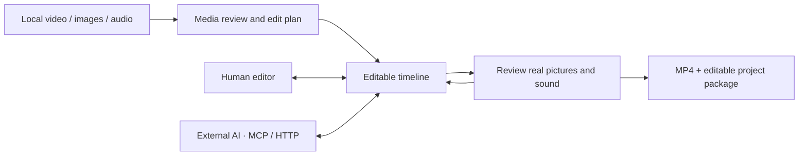
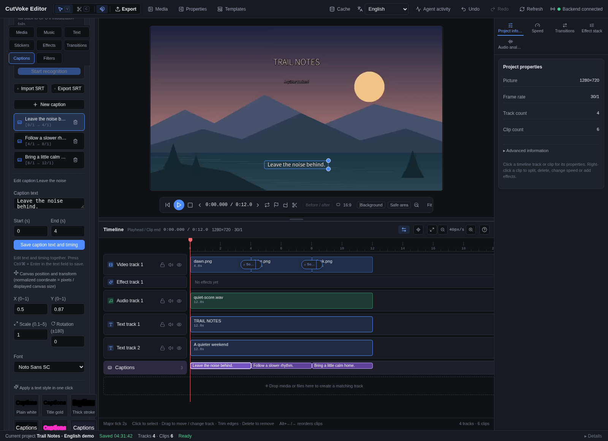
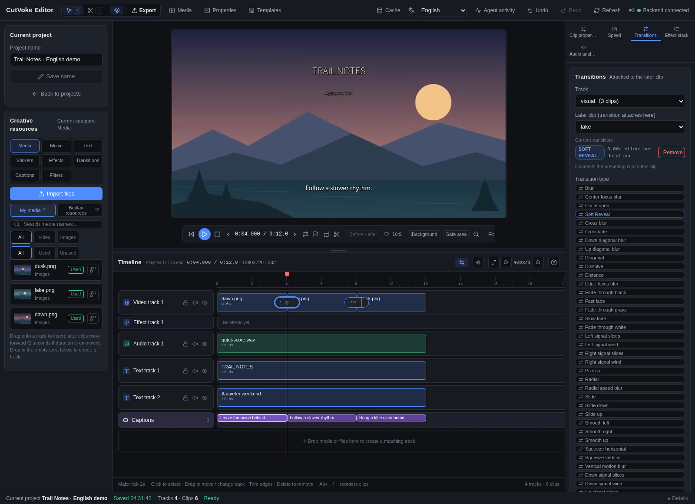

# CutVoke

**English** · [简体中文](README.zh-CN.md)

**A local video editor where you and your AI agent share the same editable timeline.**

Make a first cut from your media, ask your preferred AI to refine a shot, title or caption, then continue editing by hand. CutVoke keeps clips, text, sound and effects in a visible project you can inspect and revise.

[Get started](#get-started) · [Give your AI an editing workflow](#give-your-ai-an-editing-workflow) · [Build effects together](#build-effects-together)


*Trail Notes in the actual local editor: three original illustrations, music, titles, captions, scale keyframes and transitions. The repository example creates it through real interfaces, with no video generation service. Captured with the interface set to English, with English demo titles and captions.*

## Why try it?

A first cut often leads to many small revisions: change a subtitle, shorten the opening, replace an image, or take over an AI-assisted edit. CutVoke makes those revisions addressable changes to a visible project.

| The friction | How CutVoke helps |
| --- | --- |
| One subtitle fix restarts a whole generation workflow | Locate a caption by its text and change its words, timing or style; captions remain editable in preview |
| An AI-produced result is difficult to refine by hand | The editor, MCP, HTTP API and CLI use the same persistent project; continue on the same timeline when the agent releases its editing lease |
| Batch edits are hard to inspect or recover from | Preview supported commands before committing, inspect real frames and activity history, and group related changes into one undo operation |
| Media and project files are scattered during a handoff | Import into a persistent media library, export an MP4, or package the editable project with its media |

CutVoke edits and renders media you supply. Your external AI provides understanding, planning and review; the editor contains no large-model or video generation service. This is an early-stage project, so keep original media and independent backups.

## Who is it for, and what can you make first?

- **Video and content creators:** assemble local video, images and music into a small travel, portfolio or product edit, with titles, captions and pacing you can still adjust.
- **People who iterate on details:** ask an AI to fix one subtitle, swap a source or refine the opening, then inspect the result yourself.
- **Developers building AI editing tools:** connect locally over MCP or HTTP to reuse projects, editing commands, actual frame inspection and asynchronous export.
- **Effect and resource developers:** start from a working transition example and contribute manifests, resources and evidence through a PR.

These workflows use existing capabilities. Query the running `editor_help` and command catalog for their current parameters.

| Scenario | A reproducible starting point |
| --- | --- |
| Build an editable short | Run the 12-second example below, open its project, play it, then select a clip or caption to refine |
| Correct one subtitle | Have the agent locate the original sentence with `project_lookup`, then preview and apply `caption.update` or `caption.patch` |
| Make another version with new media | Use `project_clone`, import the replacement and apply `asset.swap`, preserving the original project |
| Deliver a video and an editable handoff | Run `project.preflight`, export asynchronously, and use `project_package` when further editing is needed |

## One project, human and AI handoffs



The timeline supports multiple media tracks, text and captions, clip adjustments, volume and fades, keyframes, and existing transitions/effects. Edits can be previewed and undone/redone; an editing lease keeps grouped agent changes from colliding with manual writes. Continuous preview prepares time windows and reuses cached work. Exports use the project version captured when queued.



*English caption editing: the selected line, its 0–4 second interval and its editable preview overlay. Captions remain individual project objects you can refine.*

## Get started

### Windows portable (x64 prerelease)

[Download Windows portable 0.3.1](https://github.com/frankShan001/CutVoke/releases/download/v0.3.1/CutVoke-0.3.1-windows-x64-portable.zip) — **363.1 MiB**, from the [v0.3.1 prerelease](https://github.com/frankShan001/CutVoke/releases/tag/v0.3.1).

1. Download the ZIP and [SHA256SUMS](https://github.com/frankShan001/CutVoke/releases/download/v0.3.1/SHA256SUMS); verify the ZIP with `Get-FileHash -Algorithm SHA256`.
2. Fully extract `CutVoke-0.3.1-windows-x64-portable.zip` into a writable folder.
3. Double-click **`CutVoke.exe`**. Keep all neighboring files.

No installer, administrator permission, Python, Node.js or system FFmpeg is needed. Basic local import, editing, preview and MP4 export work without an AI account. Optional AI clients, cloud services and speech/person models have separate requirements.

Projects, imported media, settings and caches use **`CutVoke Data` beside the executable**. Preserve it when updating; use project packaging/relink when moving media. The package is **unsigned** and may trigger SmartScreen. It passed automated Windows Server 2022 x64 frozen-package GUI, MCP, import → preview → export/decode and lifecycle checks. Manual Windows 10/11, audio/GPU and SmartScreen acceptance remain separate. See [exact hashes, storage and limits](docs/user/installation.md#windows-portable-x64).

### macOS (Apple Silicon / Intel) and Linux (x64)

The [v0.3.1 prerelease](https://github.com/frankShan001/CutVoke/releases/tag/v0.3.1) contains the original verified packages, built from `fdec479c4acbc3c685a5c8adbe8ec91621a7c194`. The tag points to documentation commit `58f890090463300c007f541ac36be8bca71bb4e9`; the binaries were not rebuilt.

| Platform | Direct Release download | Archive size |
| --- | --- | --- |
| Mac Apple Silicon | [macOS arm64 ZIP](https://github.com/frankShan001/CutVoke/releases/download/v0.3.1/CutVoke-0.3.1-macos-arm64.zip) | 335.8 MiB |
| Mac Intel | [macOS x64 ZIP](https://github.com/frankShan001/CutVoke/releases/download/v0.3.1/CutVoke-0.3.1-macos-x64.zip) | 402.8 MiB |
| Linux x64 | [Linux tar.gz](https://github.com/frankShan001/CutVoke/releases/download/v0.3.1/CutVoke-0.3.1-linux-x64.tar.gz) | 342.9 MiB |

These are the actual archives, ready to extract; no outer Actions ZIP is involved. Verify against [SHA256SUMS](https://github.com/frankShan001/CutVoke/releases/download/v0.3.1/SHA256SUMS). The built editor, frozen backend, FFmpeg/ffprobe, resources, fonts and licenses are included; basic editing needs no separate Python, Node.js or FFmpeg. [Installation and requirements](docs/user/installation.md#macos-arm64--x64) and the [original native evidence](docs/development/native-packages-verification.json) describe the exact scope.

- **macOS 13+:** choose the matching architecture, unzip and move `CutVoke.app` to `/Applications` or `~/Applications`. It has an ad-hoc integrity signature, **no Developer ID or notarization**. Gatekeeper's automatic trust checks rejected both builds. After verifying the source and SHA256, users who trust the unmodified app may follow [Apple's app-specific approval instructions](https://support.apple.com/guide/mac-help/open-a-mac-app-from-an-unknown-developer-mh40616/mac) in **System Settings → Privacy & Security → Open Anyway** after trying to open it. Keep global security protections enabled; no developer account purchase is needed. Actual automation ran on macOS 15.7.9 arm64 and Intel, not every user device or macOS 13/14.
- **Linux x64 / Ubuntu 22.04 baseline:** preserve executable permissions/symlinks while extracting the tar.gz, then run `./cutvoke` in its directory. A graphical desktop, glibc 2.35+, Electron system libraries and working unprivileged user-namespace sandbox are required. No FUSE is needed. Root, `noexec` and policies blocking the sandbox are outside this directory package's supported scope; do not use `--no-sandbox`. Other distributions, Wayland-only sessions and Ubuntu 24.04 AppArmor need separate acceptance.

Mac data lives in `~/Library/Application Support/CutVoke/`; Linux data lives in `${XDG_DATA_HOME:-~/.local/share}/CutVoke/`. Preserve it when replacing the app. Automated frozen-package import, preview, export/full decode and lifecycle checks do not establish manual audio/GPU, quarantined Finder launch or all-device acceptance.

### Run from source (developers)

You need **Python 3.10+, Node.js 20+, FFmpeg and ffprobe**. The FFmpeg build must support H.264/AAC, overlays, text and subtitle rendering; `doctor` checks the required dependencies.

```bash
git clone https://github.com/frankShan001/CutVoke.git
cd CutVoke
python -m venv .venv
```

Activate the environment before installing. Windows PowerShell:

```powershell
.\.venv\Scripts\Activate.ps1
```

macOS / Linux shell:

```bash
source .venv/bin/activate
```

Then install and build the editor:

```bash
python -m pip install -e .
cd web/app
npm ci
npm run build
cd ../..
cutvoke doctor --json
```

Make your first result without downloading sample media:

```bash
python skills/cutvoke-editor/scripts/demo.py --output .artifacts/first-edit
cutvoke serve --data .artifacts/first-edit/data
```

Open **http://127.0.0.1:8787** and select **Trail Notes · editable demo**. Success looks like a playable 12-second project with three shots, music, titles and captions, plus `trail-notes.mp4`, `trail-notes.cvkpkg` and its editable database in the output directory. Use a new output directory for each run. Stop the server with Ctrl+C. If the port is occupied, use `serve --port 8798` and open that address.

The example imports, edits and exports over real stdio MCP, then verifies that those same assets are available through the human editor API. New imports share the Web upload layout, and exact legacy MCP imports remain accessible. See [the demonstration and verification boundaries](docs/assets/readme/README.md).

The source workflow has been checked in the Linux cloud environment, including FFmpeg 7.1.5, and earlier on Windows. See [installation, tested versions and troubleshooting](docs/user/installation.md) for exact scope; the legacy Windows installer and human device acceptance still require their respective machines. On Windows, `start-cutvoke.cmd --web` also starts the browser editor using the default personal project library. For the desktop client and building an installer, see [local setup](docs/user/LOCAL_DELIVERY_MCP.md) and [the build entry point](scripts/build/build-cutvoke-desktop.cmd).

The service binds to local loopback by default. Source/CLI installs put default project data and media under the user's `.cutvoke` directory. The example above uses its own `.artifacts/first-edit/data` and does not open the default personal project library. The Windows portable edition uses its sibling `CutVoke Data` folder; native Mac/Linux desktop packages use the platform directories above.

### Choose your interface language

Use the language selector on the home screen or editor toolbar. The interface supports Simplified Chinese, Traditional Chinese, English, Japanese, Korean, Spanish, French, German, Portuguese (Brazil), Russian and Arabic. The first visit follows your preferred system/browser languages. An explicit choice stays in the browser after reload; the desktop app also saves it across restarts and uses it for its loading page and native dialog titles, summaries and action buttons. Arabic uses a right-to-left interface while the timeline keeps time moving from left to right.

Language changes affect interface labels, owned progress messages and operation prompts, not project names, captions, media filenames or saved editing data. Technical diagnostics retain their original text beneath localized summaries; resource metadata uses the author's language entries and registry fallback. Operating-system file-dialog controls follow the OS language. Translations include machine-assisted drafts and have **not been reviewed by native speakers**; corrections are welcome through the [translation guide](docs/development/translations.md).

## Give your AI an editing workflow

**Desktop packages:** after first launch, use the generated `profile/mcp-config.json` under the data root in your agent client (`CutVoke Data` for Windows). It points to the bundled engine and the same project database; a system Python is not required.

Configure the client using [the MCP connection guide](docs/user/external-agent-editing.md), and point MCP and the editor at the same `--data` directory:

```bash
cutvoke mcp --data .artifacts/first-edit/data
```

MCP already includes `editor_help` for current commands, units, recipes and error recovery. The optional [cutvoke-editor skill](skills/cutvoke-editor/SKILL.md) adds guidance for media inventory, audience and goals, shot rhythm, sound/captions, restrained transitions, preview feedback and final review.

**Use it:** copy the complete `skills/cutvoke-editor/` folder into your AI tool's skill directory, or let a tool that accepts Markdown instructions read `SKILL.md`. [The installation and usage guide](docs/user/agent-skill.md) includes concrete Codex copy commands and the verified scope. Keep `references/` and `scripts/` with the entry point.

After connecting, try a request such as:

> Use cutvoke-editor to make a 12-second weekend edit for friends from my selected local media. Keep one short title, readable captions, gentle motion and restrained transitions. Use only authorized files, create a new MP4 in my chosen directory, review actual pictures and sound, and leave an editable project.

The skill is creative guidance. It does not install a model or guarantee a polished film from installation alone. Media permissions, the agent's ability to see/listen, and editorial judgment still matter. User media must not be uploaded without authorization.

## Build effects together

Contribute useful transitions, filters, sound treatments, text animation and reusable resources. Start with a **GitHub PR** and an edit that others can preview and reproduce.



*Soft Reveal in the English interface: a contribution manifest loaded by the existing registry, previewed and exported through the existing FFmpeg dissolve algorithm.*

Start with [the contribution guide](effects/README.md) and [the runnable sample](effects/transitions/cutvoke.transition.community.soft-reveal/README.md). Store new contributions under `effects/<family>/<effect-id>/` with a manifest, description, license and actual preview. Existing assets retain their paths.

Declarative transitions can reuse supported FFmpeg mappings. Other families depend on implemented rendering semantics; a new algorithm still needs an implementation and test PR. A manifest cannot add arbitrary behavior. This contribution path offers no general dynamic-code plugin loading, automatic publication or hot reload.

## Learn more and contribute

| What you need | Documentation |
| --- | --- |
| Local startup, desktop, shared database and MCP configuration | [Local setup](docs/user/LOCAL_DELIVERY_MCP.md) |
| Agent queries, previews, leases, retries and export | [External agent editing](docs/user/external-agent-editing.md) |
| Skill installation, task inputs and runnable example | [Skill usage](docs/user/agent-skill.md) |
| Optional local transcription and model preparation | [Local speech recognition](docs/user/LOCAL_ASR.md) |
| Effect contributions and existing resource packs | [Contribution guide](effects/README.md) · [Resource packs](docs/user/resource-pack-registry.md) |
| Source conventions, layout and checks | [English](CONTRIBUTING.md) · [中文](CONTRIBUTING.zh-CN.md) · [Community tasks](docs/development/community-tasks.md) · [Project layout](docs/development/project-layout.md) |
| Installation and candidate packages | [Install / troubleshoot](docs/user/installation.md) · [Candidate packaging](docs/development/prerelease.md) |
| Security reports | [Security policy](SECURITY.md) |
| Screenshot provenance and demonstration limits | [Capture and demo notes](docs/assets/readme/README.md) |

Treat CutVoke as an early-stage project: project formats and interfaces can change, complex first previews wait for FFmpeg, and optional speech/person processing needs additional dependencies/models. The sample does not establish large-project performance, every effect or every AI client's compatibility. Try a small copy before using it for important work.

Source code uses the [MIT License](LICENSE). FFmpeg is a separate dependency with build-specific licensing and distribution requirements. Preserve the licenses and attribution of external media.
