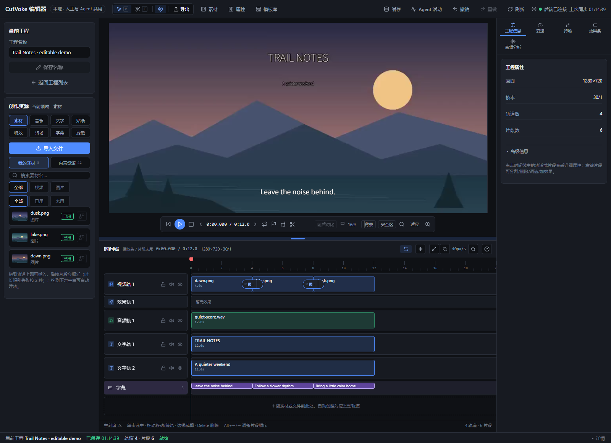
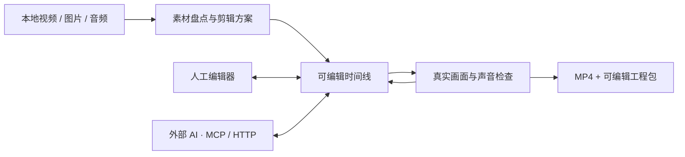
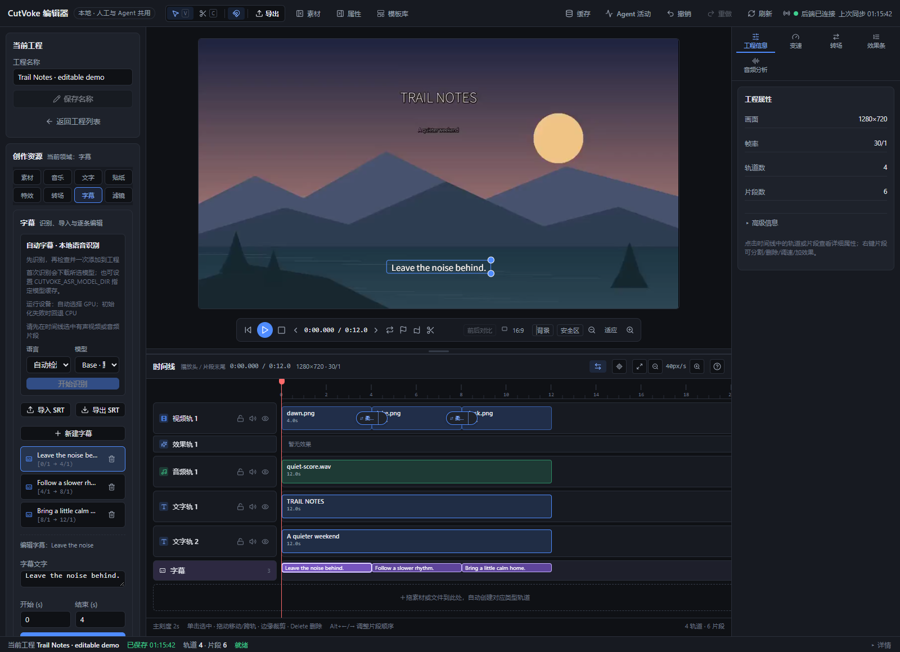
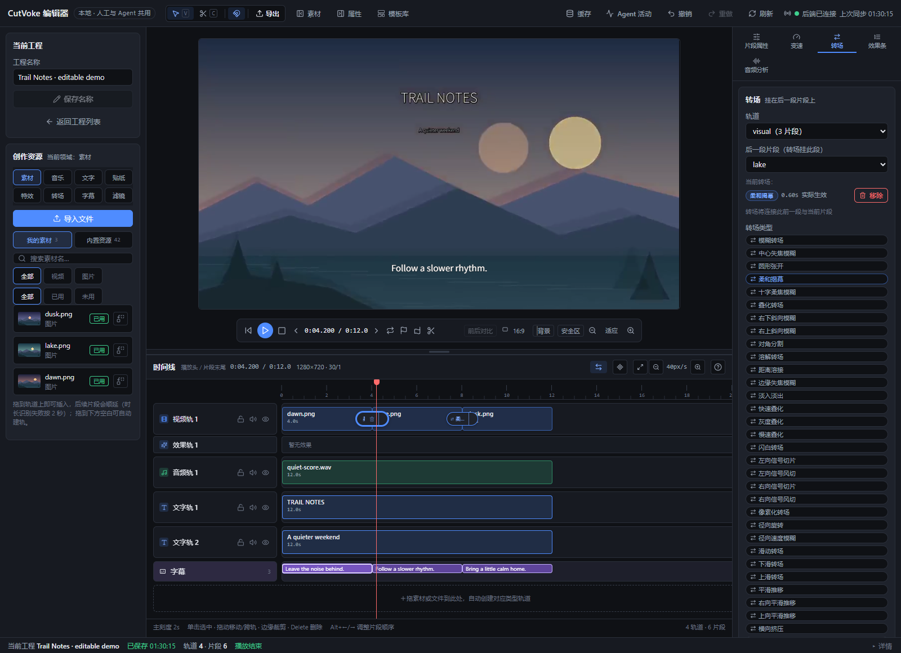

# CutVoke

[English](README.md) · **简体中文**

**让你与 AI Agent 在同一条可编辑时间线上协作的本地视频编辑器。**

把素材剪成初稿，让你熟悉的 AI 调整镜头、标题或字幕，再随时回到编辑器精修。CutVoke 保留工程中的片段、文字、声音和效果，每次修改都能继续查看和编辑。

[开始体验](#开始体验) · [给你的-ai-一套剪辑工作流](#给你的-ai-一套剪辑工作流) · [一起打造特效](#一起打造特效)



*真实本机编辑器中的 Trail Notes 演示：三张原创插画、音乐、标题、字幕、缩放关键帧和转场。由仓库示例通过真实接口创建；没有生成视频服务。截图使用简体中文，界面语言可以切换。*

## 为什么值得试

做完初稿，往往才开始反复修改：一句字幕要换、开头镜头要缩短、图片要替换，或者 AI 剪完后还要手动接着改。CutVoke 让这些改动落在可见的工程对象上。

| 你遇到的麻烦 | CutVoke 如何帮助 |
| --- | --- |
| 改一句字幕就要重新组织整套生成流程 | 按文字定位字幕，只修改它的正文、时间或样式；字幕在预览中保持可编辑 |
| AI 给出成片后，细节很难接着手工调整 | 编辑器与 MCP、HTTP API、CLI 使用同一份持久工程；AI 释放编辑租约后，你继续操作同一时间线 |
| 批量修改后难以判断发生了什么 | 先预演支持的编辑命令，查看真实帧与活动记录；组合修改可以作为一次撤销操作 |
| 原始素材与工程散落，难以交接 | 导入持久素材库，导出 MP4，或打包带素材的可编辑工程 |

CutVoke 负责剪辑和渲染你提供的素材；外部 AI 负责理解需求、规划与审片。编辑器不内置大模型或视频生成服务。项目仍在早期开发阶段，请保留原始素材和独立备份。

## 适合谁、可以先做什么

- **短视频与内容创作者**：把本地视频、图片和音乐做成小型旅行、作品集或产品短片，保留可调整的标题、字幕和节奏。
- **需要反复精修的人**：让 AI 根据反馈修改一句字幕、替换一段素材或调整开场时长，再人工检查画面。
- **构建 AI 剪辑工具的开发者**：通过本地 MCP 或 HTTP 接入工程、编辑命令、真实画面检查和异步导出，复用现有引擎。
- **制作特效与资源的开发者**：从可运行转场样例开始，用 PR 提交清单、资源和验证证据。

下面的使用方式都依赖现有功能，具体操作以运行中的 `editor_help` 与命令目录为准。

| 场景 | 可复现的做法 |
| --- | --- |
| 先做一条可编辑短片 | 运行下方 12 秒示例，打开工程，播放预览，再选中片段或字幕调整 |
| 修正一句字幕 | 让 Agent 用 `project_lookup` 找到原句，再预演并提交 `caption.update` 或 `caption.patch` |
| 用新素材制作不同版本 | 先 `project_clone`，再导入素材并使用 `asset.swap`；保留原工程 |
| 交付成片与工程 | 先 `project.preflight`，再异步导出；需要接续编辑时使用 `project_package` |

## 一条工程，人工与 AI 接力



时间线支持多轨素材、文字与字幕、片段调整、音量与淡入淡出、关键帧及现有转场/效果。编辑可预演、撤销/重做；Agent 成组修改时通过租约避免与人工写入冲突。连续预览按时间窗准备并复用缓存，导出绑定提交时的工程版本。



*字幕是可定位、可修改的工程对象。改变文字后检查真实画面，继续精修同一工程。*

## 开始体验

### 从源码运行

需要 **Python 3.10+、Node.js 20+、FFmpeg 与 ffprobe**。FFmpeg 构建需要支持 H.264/AAC、叠加、文字和字幕渲染；`doctor` 会实际检查必要依赖。

```bash
git clone https://github.com/frankShan001/CutVoke.git
cd CutVoke
python -m venv .venv
```

激活环境后再安装。Windows PowerShell：

```powershell
.\.venv\Scripts\Activate.ps1
```

macOS / Linux shell：

```bash
source .venv/bin/activate
```

然后安装并构建编辑器：

```bash
python -m pip install -e .
cd web/app
npm ci
npm run build
cd ../..
cutvoke doctor --json
```

跑出第一个结果，不需要下载演示素材：

```bash
python skills/cutvoke-editor/scripts/demo.py --output .artifacts/first-edit
cutvoke serve --data .artifacts/first-edit/data
```

打开 **http://127.0.0.1:8787**，选择 **Trail Notes · editable demo**。成功标志：你可以播放 12 秒短片，看到三段画面、音乐、标题和字幕；目录中已有 `trail-notes.mp4`、`trail-notes.cvkpkg` 和可编辑数据库。每次复验用新的输出目录；退出服务时按 Ctrl+C。若端口占用，用 `serve --port 8798` 并打开对应地址。

示例默认通过现有本机 Web 上传接口导入自制素材，再由 stdio MCP 编辑与导出。当前 MCP `media_import` 的存储格式与 Web 素材可用性判断存在差异；示例采用受支持的上传流程，详见 [演示与已知边界](docs/assets/readme/README.md)。

以上是在 Windows 上实测的源码流程；其他系统的安装和 FFmpeg 构建需要在实际环境验证。Windows 也可以用 `start-cutvoke.cmd --web` 启动浏览器编辑器，默认使用个人工程库。想运行桌面客户端或构建安装包，见 [本地使用说明](docs/user/LOCAL_DELIVERY_MCP.md) 与 [构建入口](scripts/build/build-cutvoke-desktop.cmd)。

默认服务只监听本机回环地址。普通使用的数据库和素材放在用户目录 `.cutvoke`；上面的示例使用独立 `.artifacts/first-edit/data`，不会打开默认个人工程库。

### 选择界面语言

首页和编辑器顶部均有语言选择器，支持简体中文、繁体中文、英语、日语、韩语、西班牙语、法语、德语、葡萄牙语（巴西）、俄语和阿拉伯语。首次访问按系统或浏览器偏好语言匹配；手动选择会保存在当前浏览器，刷新后仍有效。桌面版还会跨次启动保存偏好，并用于加载页及原生弹窗的标题、摘要和操作按钮。阿拉伯语采用从右到左的界面，时间线仍按从左到右的时间方向操作。

切换影响界面标签、自有进度消息和操作提示，不翻译工程名称、字幕、素材文件名或保存的剪辑数据。技术诊断保留原文，并配本地化摘要；资源元数据使用作者提供的语言项及注册表回退。文件对话框中的系统控件跟随操作系统语言。翻译包含机器辅助初稿，**尚未经母语使用者审校**；欢迎按 [翻译贡献说明](docs/development/translations.zh-CN.md) 修正。

## 给你的 AI 一套剪辑工作流

先按 [MCP 接入说明](docs/user/external-agent-editing.md) 配置客户端，并让它与编辑器使用同一 `--data` 目录：

```bash
cutvoke mcp --data .artifacts/first-edit/data
```

MCP 已自带 `editor_help`，能够查询当前命令、单位、范例与错误恢复。可选的 [cutvoke-editor 技能](skills/cutvoke-editor/SKILL.md) 进一步指导素材盘点、受众与目标、镜头节奏、声音字幕、克制转场、预览反馈与成片验收。

**使用方式**：将整个 `skills/cutvoke-editor/` 复制到 AI 工具的技能目录，或让支持 Markdown 指令的工具读取 `SKILL.md`；Codex 的具体复制命令及已验证范围见 [中文安装与使用说明](docs/user/agent-skill.zh-CN.md)。保留其 `references/` 与 `scripts/`，避免相对引用失效。

连接后可以这样给任务：

> 使用 cutvoke-editor，把我选定的本地素材剪成面向朋友的 12 秒周末短片。保留一个短标题、可读字幕、轻微运镜与克制转场。只用获准的素材，在指定目录创建新 MP4，检查真实画面与声音，并留下可继续编辑的工程。

技能是创作指导，不会安装模型，也不保证仅靠安装就能得到精美成片。素材权限、视觉/听音能力和审片判断仍然重要；未经授权不上传用户素材。

## 一起打造特效

欢迎贡献有用的转场、滤镜、声音处理、文字动画和可复用资源。以 **GitHub PR** 为入口，把想法变成可预览、可复验的作品。



*真实编辑器中的 Soft Reveal：按现有注册表加载贡献清单，并通过现有 FFmpeg 叠化算法预览与导出。*

从 [中文贡献指南](docs/user/effect-contributing.zh-CN.md) 和 [可运行样例](effects/transitions/cutvoke.transition.community.soft-reveal/README.md) 开始。新贡献按 `effects/<类型>/<效果ID>/` 保存清单、说明、许可证和真实预览；既有资源保持原路径。

现有声明式转场可复用 FFmpeg 映射；其他类型依赖已实现的渲染语义。新增算法仍需要实现和测试 PR，不能只靠清单增加任意行为。当前贡献路径不提供通用动态代码插件、自动发布或热加载。

## 深入了解与参与

| 想了解什么 | 文档 |
| --- | --- |
| 本地启动、桌面、共享数据库与 MCP 配置 | [本地使用](docs/user/LOCAL_DELIVERY_MCP.md) |
| Agent 查询、预演、租约、重试与导出 | [外部 Agent 接入](docs/user/external-agent-editing.md) |
| 技能复制、任务输入及可运行示例 | [技能使用](docs/user/agent-skill.zh-CN.md) |
| 可选本地转写与模型准备 | [本地语音识别](docs/user/LOCAL_ASR.md) |
| 特效贡献与现有资源包机制 | [贡献指南](docs/user/effect-contributing.zh-CN.md) · [资源包](docs/user/resource-pack-registry.md) |
| 源码、目录规范与提交检查 | [CONTRIBUTING](CONTRIBUTING.md) · [目录说明](docs/development/project-layout.md) |
| 截图来源与演示验证边界 | [截图与演示记录](docs/assets/readme/README.md) |

目前应将 CutVoke 视为早期项目：工程格式和接口可能调整，首次复杂预览需要等待 FFmpeg，可选语音识别与人物处理另需依赖/模型。示例不能代表长工程性能、所有效果或所有 AI 客户端兼容性。请先在小型副本中试用，再用于重要项目。

源码使用 [MIT License](LICENSE)。FFmpeg 是独立依赖，具体构建的许可证与分发要求单独适用；外部素材应保留各自授权与署名。
