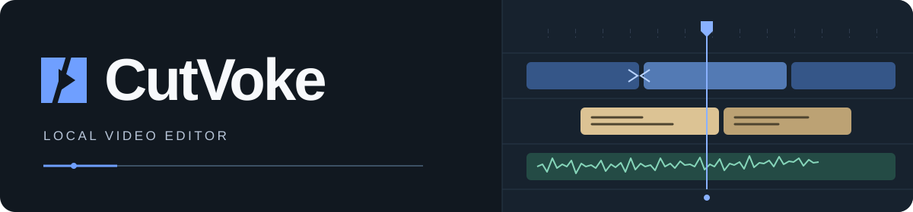
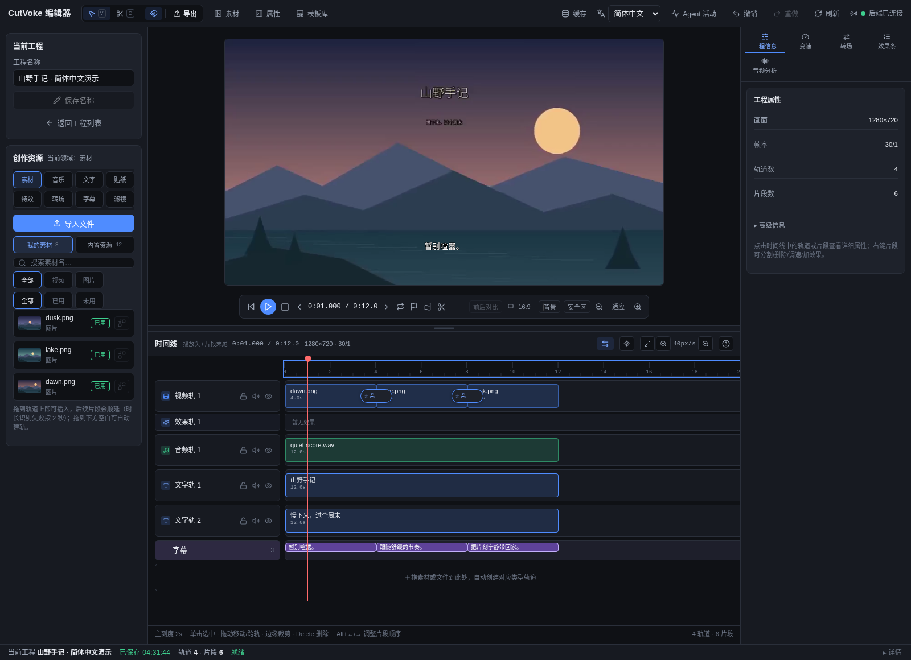
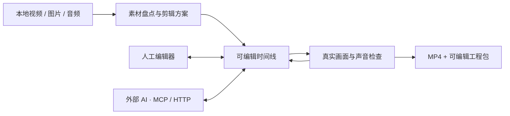
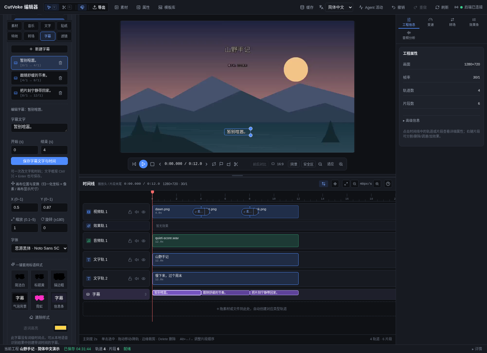
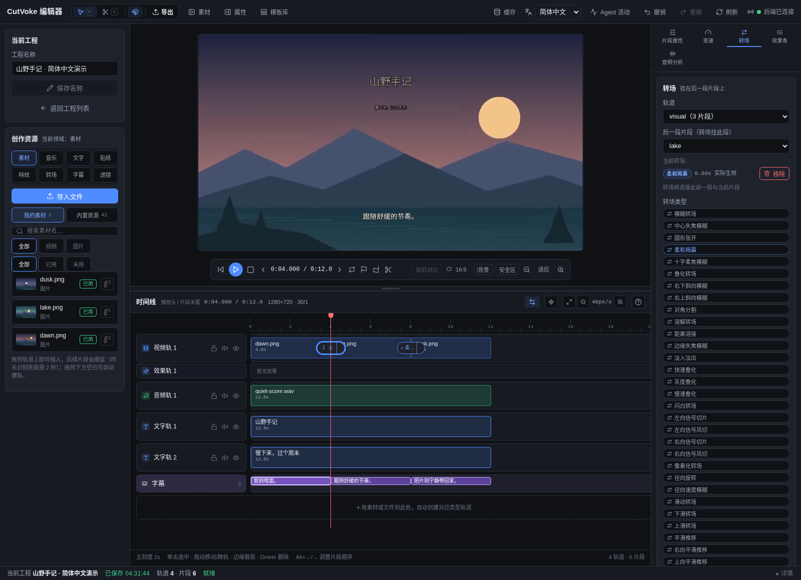

<p align="center">
  
</p>

<h3 align="center">你的素材，你的 AI，同一条可编辑时间线。</h3>

<p align="center">用你熟悉的 AI 剪出初稿，随时回到编辑器精修。每一次修改，都留在可继续编辑的本地工程里。</p>

<p align="center">
  <a href="https://github.com/frankShan001/CutVoke/releases/tag/v0.3.1"></a>
  <a href="https://github.com/frankShan001/CutVoke/actions/workflows/ci.yml"></a>
  <a href="LICENSE"></a>
</p>

<p align="center"><a href="#开始体验">下载体验</a> · <a href="#看看两个完整剪辑案例">观看案例</a> · <a href="#给你的-ai-一套剪辑工作流">接入 AI</a> · <a href="#深入了解与参与">文档</a> · <a href="CONTRIBUTING.zh-CN.md">参与贡献</a></p>

<p align="center"><a href="README.md">English</a> · <strong>简体中文</strong></p>

<table>
<tr>
<td width="33%" valign="top"><strong>剪辑看得见</strong><br/>多轨 · 字幕 · 特效</td>
<td width="33%" valign="top"><strong>与 Agent 协作</strong><br/>MCP · HTTP · CLI</td>
<td width="33%" valign="top"><strong>继续你的创作</strong><br/>MP4 + 可编辑工程</td>
</tr>
</table>

## 看看两个完整剪辑案例

先看原始素材，再看完整剪辑。两个案例都提供 **中英文视频、原始素材和可编辑工程**；本页播放器使用中文版，打开声音即可观看。

### 01 · 逐光而行

**摩托短片 · 31.6 秒 · 横屏**

https://github.com/user-attachments/assets/5647c4b6-2b2b-45db-bda4-e6ad83a4eca3

**看这些效果：**移动遮罩、碎片重构、光源锚点跟踪、多层光影和动态文字。先展示四段 MiniMax 原始镜头，再播放 22.3 秒成片；片内文字已中文化。

[下载中文纯成片](https://media.githubusercontent.com/media/frankShan001/CutVoke/main/examples/showcases/chase-the-light/videos/motorcycle-film_zh-CN.mp4) · [中文完整剪辑工程](examples/showcases/chase-the-light/projects/motorcycle-edit_zh-CN.cutvokepack) · [素材与中英文版本](examples/showcases/chase-the-light/README.zh-CN.md)

### 02 · 海岸快乐日记

**手持旅拍 · 42.5 秒 · 9:16 竖屏**

https://github.com/user-attachments/assets/1210c3ae-eb37-47db-b1c7-1598f4e7b136

摆拍被海浪打断，摄影师先笑场，两个人留下快乐回忆。**看这些效果：**分屏、彩色分层花字、曲线变速、遮罩、调色与声音衔接；音乐下保留环境声。

[下载中文纯成片](https://media.githubusercontent.com/media/frankShan001/CutVoke/main/examples/showcases/travel-vlog/videos/travel-vlog-film_zh-CN.mp4) · [中文可编辑工程](examples/showcases/travel-vlog/projects/travel-vlog_zh-CN.cutvokepack) · [素材与中英文版本](examples/showcases/travel-vlog/README.zh-CN.md)

全部时间线剪辑、合成、混音与 MP4 导出均由 CutVoke 完成。视频、原始素材和工程包使用 Git LFS，克隆后运行 `git lfs pull`。在 CutVoke 首页通过「解包打开」导入 `.cutvokepack`，即可继续编辑。

## 在编辑器里，继续你的创作



*真实本机编辑器中的「山野手记」演示：三张原创插画、音乐、标题、字幕、缩放关键帧和转场。由仓库示例通过真实接口创建；没有生成视频服务。界面、演示标题与字幕均使用简体中文。*

## 为什么值得试

初稿之后的一句字幕、一段配乐、一次镜头调整，都可以落在具体的工程对象上。

| 你遇到的麻烦 | CutVoke 如何帮助 |
| --- | --- |
| 改一句字幕就要重新组织整套生成流程 | 按文字定位字幕，只修改它的正文、时间或样式；字幕在预览中保持可编辑 |
| AI 给出成片后，细节很难接着手工调整 | 编辑器与 MCP、HTTP API、CLI 使用同一份持久工程；AI 释放编辑租约后，你继续操作同一时间线 |
| 批量修改后难以判断发生了什么 | 先预演支持的编辑命令，查看真实帧与活动记录；组合修改可以作为一次撤销操作 |
| 原始素材与工程散落，难以交接 | 导入持久素材库，导出 MP4，或打包带素材的可编辑工程 |

CutVoke 负责剪辑和渲染你提供的素材；外部 AI 负责理解需求、规划与审片。编辑器不内置大模型或视频生成服务。项目仍在早期开发阶段，请保留原始素材和独立备份。

<details>
<summary><strong>四种可以马上开始的用法</strong></summary>

| 场景 | 可复现的做法 |
| --- | --- |
| 先做一条可编辑短片 | 运行下方 12 秒示例，打开工程，播放预览，再选中片段或字幕调整 |
| 修正一句字幕 | 让 Agent 用 `project_lookup` 找到原句，再预演并提交 `caption.update` 或 `caption.patch` |
| 用新素材制作不同版本 | 先 `project_clone`，再导入素材并使用 `asset.swap`；保留原工程 |
| 交付成片与工程 | 先 `project.preflight`，再异步导出；需要接续编辑时使用 `project_package` |

</details>

<details>
<summary><strong>查看人工与 AI 如何接力</strong></summary>



时间线支持多轨素材、文字与字幕、片段调整、音量与淡入淡出、关键帧及现有转场/效果。编辑可预演、撤销/重做；Agent 成组修改时通过租约避免与人工写入冲突。连续预览按时间窗准备并复用缓存，导出绑定提交时的工程版本。

最新源码版的[制作工作流](docs/production-workflow.md)还支持纯文字标题卡、绑定图层整组复用、按需预览和制作归档。



*简体中文界面中的字幕编辑：选中「暂别喧嚣。」，查看 0–4 秒区间及可编辑画面叠层，继续精修同一工程。*

</details>

## 开始体验

**直接下载，解压启动。** 基础本地导入、剪辑、预览与 MP4 导出无需 AI 账号，也无需另装 Python、Node.js 或 FFmpeg。

| 你的设备 | v0.3.1 预发布 |
| --- | --- |
| Windows x64 | [免安装 ZIP](https://github.com/frankShan001/CutVoke/releases/download/v0.3.1/CutVoke-0.3.1-windows-x64-portable.zip) |
| Mac · Apple Silicon | [arm64 ZIP](https://github.com/frankShan001/CutVoke/releases/download/v0.3.1/CutVoke-0.3.1-macos-arm64.zip) |
| Mac · Intel | [x64 ZIP](https://github.com/frankShan001/CutVoke/releases/download/v0.3.1/CutVoke-0.3.1-macos-x64.zip) |
| Linux x64 | [tar.gz](https://github.com/frankShan001/CutVoke/releases/download/v0.3.1/CutVoke-0.3.1-linux-x64.tar.gz) |

[校验 SHA-256](https://github.com/frankShan001/CutVoke/releases/download/v0.3.1/SHA256SUMS) · [安装与排障](docs/user/installation.md) · [全部发行包](https://github.com/frankShan001/CutVoke/releases/tag/v0.3.1)

> [!NOTE]
> 上方视频案例使用最新源码版制作，部分效果和工程包功能晚于 v0.3.1。复现这两个案例时，请使用下方源码启动方式。

<details>
<summary><strong>Windows 免安装便携版（x64 预发布）</strong></summary>

[下载 Windows 便携版 0.3.1](https://github.com/frankShan001/CutVoke/releases/download/v0.3.1/CutVoke-0.3.1-windows-x64-portable.zip) — **363.1 MiB**，来自 [v0.3.1 预发布](https://github.com/frankShan001/CutVoke/releases/tag/v0.3.1)。

1. 下载 ZIP 和 [SHA256SUMS](https://github.com/frankShan001/CutVoke/releases/download/v0.3.1/SHA256SUMS)，用 `Get-FileHash -Algorithm SHA256` 核对 ZIP。
2. 将 `CutVoke-0.3.1-windows-x64-portable.zip` **完整解压到可写文件夹**。
3. 双击 **`CutVoke.exe`**，保留旁边的所有文件。

没有安装向导，**无需管理员，也不用配置 Python、Node.js 或系统 FFmpeg**。基础本地导入、剪辑、预览和 MP4 导出不需要 AI 账号；外部 AI 客户端、云服务及可选语音/人物模型另有要求。

工程、素材、设置和缓存默认放在 **exe 旁的 `CutVoke Data`**，更新时保留；换路径或电脑时使用工程打包或重新关联。包**未签名**，可能出现 SmartScreen。真实成品已通过 Windows Server 2022 x64 上的 GUI、MCP、导入 → 预览 → 导出/解码和生命周期自动验收；Windows 10/11、音频/GPU 和 SmartScreen 的人工体验仍需分别检查。[准确哈希、存储位置与边界](docs/user/installation.md#windows-portable-x64)见安装说明。

</details>

<details>
<summary><strong>macOS（Apple Silicon / Intel）和 Linux（x64）</strong></summary>

[v0.3.1 预发布](https://github.com/frankShan001/CutVoke/releases/tag/v0.3.1) 提供已验证的原始包，二进制实际构建自 `fdec479c4acbc3c685a5c8adbe8ec91621a7c194`；标签指向文档提交 `58f890090463300c007f541ac36be8bca71bb4e9`，本次未重新构建二进制。

附件就是可直接解压的真实发行包，无需再取出 Actions 外层 ZIP。请核对 [SHA256SUMS](https://github.com/frankShan001/CutVoke/releases/download/v0.3.1/SHA256SUMS)。内含编辑器、冻结后端、FFmpeg/ffprobe、资源、字体和许可，基础剪辑无需另装 Python、Node.js 或 FFmpeg。[安装与系统要求](docs/user/installation.md#macos-arm64--x64)和[原生验证记录](docs/development/native-packages-verification.json)列明准确范围。

- **macOS 13+：**按芯片选择架构，解压后把 `CutVoke.app` 移到 `/Applications` 或 `~/Applications`。仅有 ad-hoc 完整性签名，**没有 Developer ID 和公证**，两种架构的 Gatekeeper 自动信任检查均拒绝。确认来源可信且 SHA256 一致后，可按 [Apple 针对该 app 的确认打开说明](https://support.apple.com/guide/mac-help/open-a-mac-app-from-an-unknown-developer-mh40616/mac)，在尝试启动后到 **系统设置 → 隐私与安全性 → 仍要打开**确认；保持全局安全保护开启，无需购买开发者账号。实际自动执行环境为两种架构的 macOS 15.7.9，未宣称覆盖 macOS 13/14 或所有用户设备。
- **Linux x64 / Ubuntu 22.04 基线：**保留执行权限和符号链接解压 tar.gz，在目录运行 `./cutvoke`。需图形桌面、glibc 2.35+、Electron 系统库和非特权用户命名空间沙箱；无需 FUSE。不支持 root、`noexec` 或阻止沙箱的系统策略，不使用 `--no-sandbox`。其他发行版、Wayland-only 和 Ubuntu 24.04 AppArmor 需独立验收。

Mac 数据位于 `~/Library/Application Support/CutVoke/`，Linux 位于 `${XDG_DATA_HOME:-~/.local/share}/CutVoke/`；更新应用时保留。真实冻结包导入、预览、导出/完整解码和生命周期自动验收，不等于手工音质、设备 GPU、带隔离标记的 Finder 首次启动或所有系统测试。

</details>

<details>
<summary><strong>从源码运行，并制作第一条 12 秒短片</strong></summary>

需要 **Python 3.10+、Node.js 20+、FFmpeg 与 ffprobe**。FFmpeg 构建需要支持 H.264/AAC、叠加、文字和字幕渲染；`doctor` 会实际检查必要依赖。

```bash
git clone https://github.com/frankShan001/CutVoke.git
cd CutVoke
python -m venv .venv
```

激活环境后再安装。Windows PowerShell：

```powershell
.\.venv\Scripts\Activate.ps1
```

macOS / Linux shell：

```bash
source .venv/bin/activate
```

然后安装并构建编辑器：

```bash
python -m pip install -e .
cd web/app
npm ci
npm run build
cd ../..
cutvoke doctor --json
```

跑出第一个结果，不需要下载演示素材：

```bash
python skills/cutvoke-editor/scripts/demo.py --output .artifacts/first-edit
cutvoke serve --data .artifacts/first-edit/data
```

打开 **http://127.0.0.1:8787**，选择 **Trail Notes · editable demo**。成功标志：你可以播放 12 秒短片，看到三段画面、音乐、标题和字幕；目录中已有 `trail-notes.mp4`、`trail-notes.cvkpkg` 和可编辑数据库。每次复验用新的输出目录；退出服务时按 Ctrl+C。若端口占用，用 `serve --port 8798` 并打开对应地址。

示例默认通过真实 stdio MCP 导入、编辑与导出，再从人工编辑器接口检查同一批素材可用。新导入与 Web 上传共用标准存储路径，旧 MCP 导入也按严格路径规则保持可用，详见 [演示与验证边界](docs/assets/readme/README.md)。

源码流程已在云 Linux（含 FFmpeg 7.1.5）实测，之前也检查过 Windows 源码路径。准确范围见[安装、已测版本与排障](docs/user/installation.md)；旧 Windows 安装包与人工设备体验仍需分别验收。Windows 也可以用 `start-cutvoke.cmd --web` 启动浏览器编辑器，默认使用个人工程库。想运行桌面客户端或构建安装包，见 [本地使用说明](docs/user/LOCAL_DELIVERY_MCP.md) 与 [构建入口](scripts/build/build-cutvoke-desktop.cmd)。

默认服务只监听本机回环地址。源码/CLI 版的默认数据库和素材放在用户目录 `.cutvoke`；上面的示例使用独立 `.artifacts/first-edit/data`，不会打开默认个人工程库。Windows 便携版使用 exe 旁的 `CutVoke Data`，Mac/Linux 桌面包使用上方平台数据目录。

</details>

<details>
<summary><strong>界面语言与翻译说明</strong></summary>

首页和编辑器顶部均有语言选择器，支持简体中文、繁体中文、英语、日语、韩语、西班牙语、法语、德语、葡萄牙语（巴西）、俄语和阿拉伯语。首次访问按系统或浏览器偏好语言匹配；手动选择会保存在当前浏览器，刷新后仍有效。桌面版还会跨次启动保存偏好，并用于加载页及原生弹窗的标题、摘要和操作按钮。阿拉伯语采用从右到左的界面，时间线仍按从左到右的时间方向操作。

切换影响界面标签、自有进度消息和操作提示，不翻译工程名称、字幕、素材文件名或保存的剪辑数据。技术诊断保留原文，并配本地化摘要；资源元数据使用作者提供的语言项及注册表回退。文件对话框中的系统控件跟随操作系统语言。翻译包含机器辅助初稿，**尚未经母语使用者审校**；欢迎按 [翻译贡献说明](docs/development/translations.zh-CN.md) 修正。

</details>

## 给你的 AI 一套剪辑工作流

**桌面发行包**：首次启动后，将数据根目录下 `profile/mcp-config.json` 的内容配置到 Agent 客户端（Windows 为 `CutVoke Data`）。它使用内置后端与同一工程库，不需要系统 Python。

先按 [MCP 接入说明](docs/user/external-agent-editing.md) 配置客户端，并让它与编辑器使用同一 `--data` 目录：

```bash
cutvoke mcp --data .artifacts/first-edit/data
```

<details>
<summary><strong>安装剪辑技能，并尝试一个创作任务</strong></summary>

MCP 已自带 `editor_help`，能够查询当前命令、单位、范例与错误恢复。可选的 [cutvoke-editor 技能](skills/cutvoke-editor/SKILL.md) 进一步指导素材盘点、受众与目标、镜头节奏、声音字幕、克制转场、预览反馈与成片验收。

标准 MCP 启动入口会自动切换到通过检查的新引擎，保持连接和已提交的渲染任务。详见[自动更新行为与边界](docs/production-workflow.md#runtime-changes--服务版本变化)；之前已经运行的旧启动器首次接入时需要重连一次。

**使用方式**：将整个 `skills/cutvoke-editor/` 复制到 AI 工具的技能目录，或让支持 Markdown 指令的工具读取 `SKILL.md`；Codex 的具体复制命令及已验证范围见 [中文安装与使用说明](docs/user/agent-skill.zh-CN.md)。保留其 `references/` 与 `scripts/`，避免相对引用失效。

连接后可以这样给任务：

> 使用 cutvoke-editor，把我选定的本地素材剪成面向朋友的 12 秒周末短片。保留一个短标题、可读字幕、轻微运镜与克制转场。只用获准的素材，在指定目录创建新 MP4，检查真实画面与声音，并留下可继续编辑的工程。

技能是创作指导，不会安装模型，也不保证仅靠安装就能得到精美成片。素材权限、视觉/听音能力和审片判断仍然重要；未经授权不上传用户素材。

</details>

## 一起打造特效

正常使用 AI 剪辑时，就能把有用的效果保存为本地模块，应用、撤销/重做，再导出只含配方的贡献 ZIP。这条路径无需开发环境或类型目录设置。包内不包含用户视频、图片、音频、文字/字幕正文、工程、路径和编辑历史；AI 每次建议分享时必须明确说明隐私边界。本地准备不会上传，公开提交需要用户明确同意。见[具体流程与隐私约束](docs/user/effect-contributing.zh-CN.md#边剪辑边创作无需开发环境)。

[中文贡献指南](docs/user/effect-contributing.zh-CN.md) · [可运行转场样例](effects/transitions/cutvoke.transition.community.soft-reveal/README.md)

<details>
<summary><strong>查看真实转场示例与贡献边界</strong></summary>



*简体中文界面中的「柔和揭幕」（Soft Reveal）：按现有注册表加载贡献清单，并通过现有 FFmpeg 叠化算法预览与导出。*

从 [中文贡献指南](docs/user/effect-contributing.zh-CN.md) 和 [可运行样例](effects/transitions/cutvoke.transition.community.soft-reveal/README.md) 开始。新贡献按 `effects/<类型>/<效果ID>/` 保存清单、说明、许可证和真实预览；既有资源保持原路径。

现有声明式转场可复用 FFmpeg 映射；其他类型依赖已实现的渲染语义。新增算法仍需要实现和测试 PR，不能只靠清单增加任意行为。当前贡献路径不提供通用动态代码插件、自动发布或热加载。

</details>

## 深入了解与参与

| 想了解什么 | 文档 |
| --- | --- |
| 本地启动、桌面、共享数据库与 MCP 配置 | [本地使用](docs/user/LOCAL_DELIVERY_MCP.md) |
| Agent 查询、预演、租约、重试与导出 | [外部 Agent 接入](docs/user/external-agent-editing.md) |
| 技能复制、任务输入及可运行示例 | [技能使用](docs/user/agent-skill.zh-CN.md) |
| 可选本地转写与模型准备 | [本地语音识别](docs/user/LOCAL_ASR.md) |
| 特效贡献与现有资源包机制 | [贡献指南](docs/user/effect-contributing.zh-CN.md) · [资源包](docs/user/resource-pack-registry.md) |
| 源码、目录规范与提交检查 | [中文贡献指南](CONTRIBUTING.zh-CN.md) · [English](CONTRIBUTING.md) · [可认领任务](docs/development/community-tasks.md) · [目录说明](docs/development/project-layout.md) |
| 安装与候选包 | [安装排障](docs/user/installation.md) · [预发布流程](docs/development/prerelease.md) |
| 安全报告 | [安全报告说明](SECURITY.md) |
| 截图来源与演示验证边界 | [截图与演示记录](docs/assets/readme/README.md) |
| 正式 CV 图标、平台资源与重新生成 | [CutVoke 品牌资源](docs/assets/brand/README.md) |

目前应将 CutVoke 视为早期项目：工程格式和接口可能调整，首次复杂预览需要等待 FFmpeg，可选语音识别与人物处理另需依赖/模型。示例不能代表长工程性能、所有效果或所有 AI 客户端兼容性。请先在小型副本中试用，再用于重要项目。

源码使用 [MIT License](LICENSE)。FFmpeg 是独立依赖，具体构建的许可证与分发要求单独适用；外部素材应保留各自授权与署名。

---

**一起把下一次剪辑做得更好。** [反馈问题](https://github.com/frankShan001/CutVoke/issues) · [认领任务](docs/development/community-tasks.md) · [贡献特效](docs/user/effect-contributing.zh-CN.md)

如果 CutVoke 帮到了你，欢迎点一颗 Star，让更多创作者发现它。
