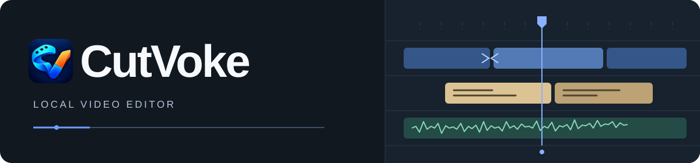
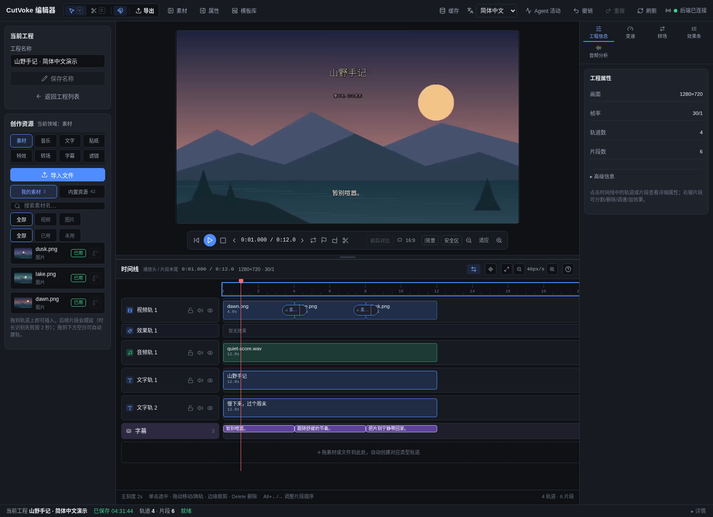
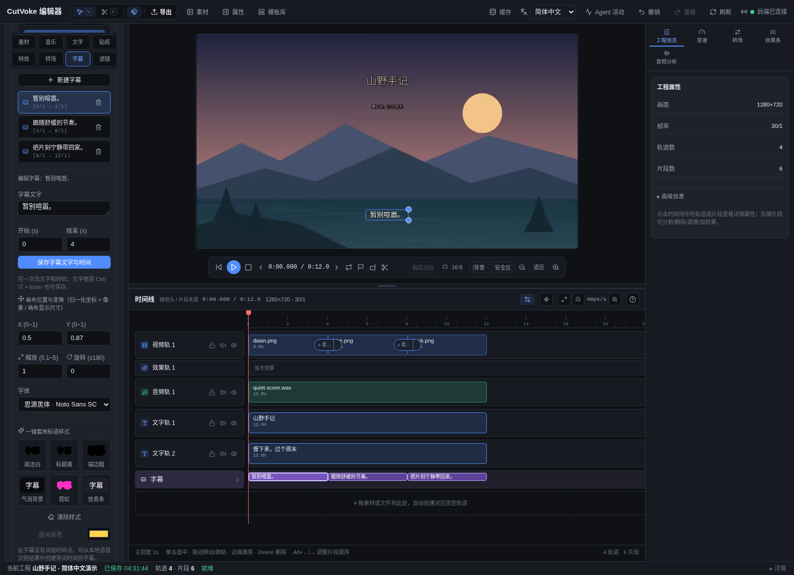
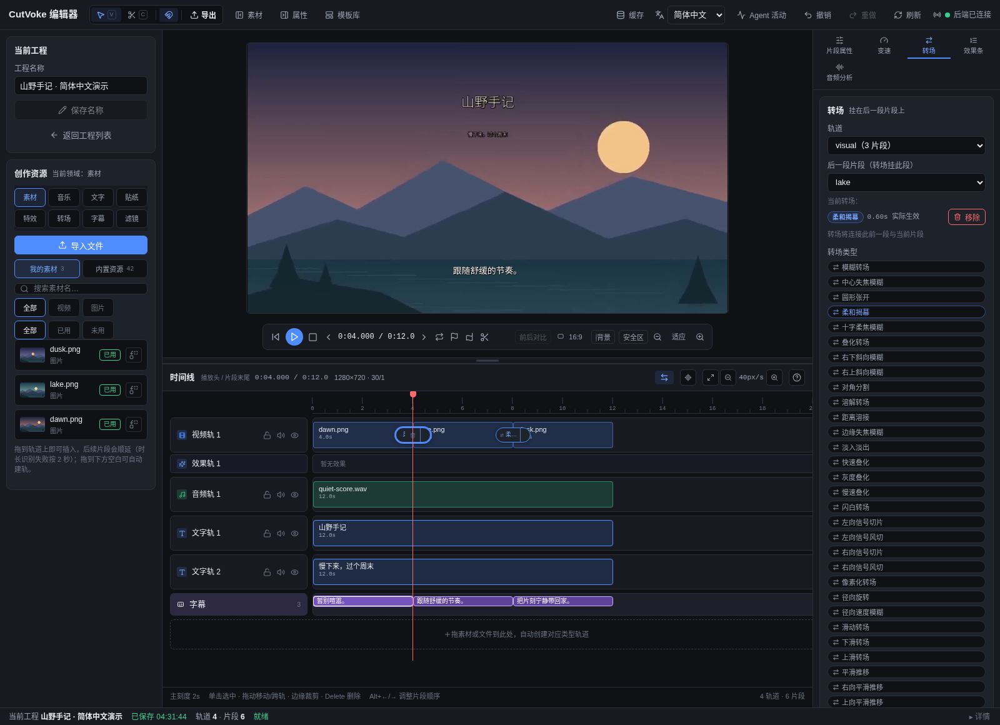

<div align="center">



# CutVoke

**你的素材，你的 AI，同一条可编辑时间线。**

*一款本地优先（Local-First）的开源视频剪辑软件。人类创作者与 AI Agent 共享同一条非破坏性时间线——既能用可视化界面精细打磨每一帧，也能接入 MCP 让 AI 自动完成粗剪、字幕与特效，并支持社区共建可复用的特效生态。*

[](https://github.com/frankShan001/CutVoke/releases)
[](LICENSE)
[](pyproject.toml)
[](docs/user/LOCAL_DELIVERY_MCP.md)
[](https://ffmpeg.org/)

[**English**](README.md) | [**简体中文**](README.zh-CN.md)

[下载桌面版](https://github.com/frankShan001/CutVoke/releases) · [v0.3.5 最新动态](docs/development/release-notes-v0.3.5.md) · [观看剪辑案例](examples/showcases/) · [接入 AI Agent](docs/user/agent-skill.zh-CN.md) · [贡献社区特效](CONTRIBUTING.zh-CN.md)

</div>

<p align="center">
  
</p>

> **CutVoke 是一款开源、本地运行的视频剪辑软件：你的 AI Agent 通过 MCP 直接剪时间线，你也能打开同一条时间线随时手动修改。**
> Instagram 新推出的 Edits for Mac 也提供了 MCP，但只支持 macOS（Apple 芯片），而且要登录 Instagram 账号。CutVoke 支持 **Windows · macOS · Linux**，本地剪辑无需账号，源码采用 MIT 协议。
> 适用于 Claude Code、Codex、Cursor、Claude Desktop 以及任何 MCP 客户端。

**30 秒接入你的 Agent**

1. [下载 CutVoke v0.3.5](https://github.com/frankShan001/CutVoke/releases/tag/v0.3.5) 并启动一次。
2. 打开数据目录下的 `profile/mcp-config.json`（Windows 便携版：exe 旁的 `CutVoke Data`；macOS：`~/Library/Application Support/CutVoke/`；Linux：`${XDG_DATA_HOME:-~/.local/share}/CutVoke/`）。里面已经写好了内置引擎的命令，不需要另装 Python。
3. 把其中的 `cutvoke` 配置加到你的 Agent：[Claude Code](docs/integrations/claude-code.md) · [Codex](docs/integrations/codex.md) · [Cursor](docs/integrations/cursor.md)。然后直接说："剪掉停顿、加字幕、出一个 9:16 竖版，导出前先给我看几帧。"

⭐ **觉得有用的话，点个 Star 能让更多创作者找到它。**

## v0.3.5 最新更新速览

- **按文剪辑视频**：支持按句/词定位试听、预览删减影响，并支持一键同步撤销音画与字幕修改。
- **AI 方案审阅与修补**：新增结构化 AI 创作提案、渲染帧证据审阅与局部修补（Patch）MCP 工作流。
- **代码视频与缓存渲染**：支持外部代码视频（Code Video）清单静态校验导入，以及帧窗口缓存复用渲染。
- **极速启动与精准切镜**：优化内置音频/背景冷启动读取，统一工程帧时钟消除各帧率下透明轨道单帧残留。
- **3D 引擎与合成升级 (v0.3.3–v0.3.4)**：新增 OpenGL 3D 图层、轨道遮罩、调整图层、五大 AI 题材规范与 GPU 加速预览（[发布说明](docs/development/release-notes-v0.3.5.md) · [更新日志](CHANGELOG.md)）。

## 观看产品介绍

<p>
  <a href="https://www.bilibili.com/video/BV18VHA62EZ1/"></a>
  &nbsp;
  <a href="https://www.youtube.com/watch?v=2--4_XO15RI"></a>
</p>

## 为什么选择 CutVoke？

市面上大多数 AI 视频工具只能给你一个“无法修改”的黑盒 MP4 成片——哪怕只有一个镜头切错了、一行字幕写错了，你也只能重新抽卡或者导出到传统剪辑软件里重头再来；而完全用传统剪辑软件手动切气口、对字幕、K 关键帧，又极其耗费精力。

**CutVoke 把控制权交还给你。** 在这里，人类创作者与 AI Agent 操作的是**同一条可随时修改的多轨时间线**：

| 创作痛点 | 传统非线性剪辑软件 | 黑盒 AI 视频生成工具 | CutVoke（人机共享时间线） |
| :--- | :--- | :--- | :--- |
| **粗剪与素材组装** | 手动逐段拉片、切片、排列轨道 | 一键成片，但无法干预内部镜头 | AI Agent 自动完成多轨粗剪与卡点；你随时在界面中微调任意一帧 |
| **后期修改与精修** | 100% 精细可控，但极其耗时 | 只能重写提示词重新生成 | 支持按台词删减片段、鼠标拖拽修剪、调关键帧，或让 AI 局部修补指定轨道 |
| **字幕生成与对轴** | 手动打轴或依赖付费云端识别 | 字幕直接烧死在画面中无法修改 | 内置本地 ASR 离线语音识别，生成独立可编辑字幕轨并自由调整样式 |
| **转场与视觉特效** | 复杂的节点编排或封闭式商业插件 | 画面伪影多，效果不可控 | 参数化、可复用的开源社区特效配方（[`effects/`](effects/)） |
| **隐私安全与成本** | 商业软件订阅昂贵，工程格式封闭 | 素材需上传云端，按分钟扣取算力费 | **100% 本地优先**，基于本地 FFmpeg 渲染导出 MP4 + 开放工程文件 |

<div align="center">
  
</div>

| 可视化字幕精修与按文本剪辑 | 社区可复用转场与视觉特效 |
| :---: | :---: |
|  |  |
| 离线识别语音生成独立字幕轨，支持按词/按句联动删减音画与调整动画样式 | 在任意剪切点一键应用参数化的社区转场与滤镜配方 |

## 看看两个完整剪辑案例

先看原始素材，再看完整剪辑。两个案例都提供 **中英文视频、原始素材和可编辑工程**；可直接播放下方带声音的视频，也可下载对应 MP4。

### 01 · 逐光而行

**摩托短片 · 31.6 秒 · 横屏**

https://github.com/user-attachments/assets/5647c4b6-2b2b-45db-bda4-e6ad83a4eca3

[下载带声音的中文对比片](https://raw.gitcode.com/shansjl/CutVoke/blobs/d7c695df7edf271d4964701c6dd297e1e2b1ec05/examples/showcases/chase-the-light/videos/motorcycle-case_zh-CN.mp4) · [打开仓库视频页](examples/showcases/chase-the-light/videos/motorcycle-case_zh-CN.mp4)

**看这些效果：** 移动遮罩、碎片重构、光源锚点跟踪、多层光影和动态文字。先展示四段 MiniMax 原始镜头，再播放 22.3 秒成片；片内文字已中文化。

[下载中文纯成片](https://raw.gitcode.com/shansjl/CutVoke/blobs/a638300c241104d5129e17a47e9f96e161ef3365/examples/showcases/chase-the-light/videos/motorcycle-film_zh-CN.mp4) · [中文完整剪辑工程](examples/showcases/chase-the-light/projects/motorcycle-edit_zh-CN.cutvokepack) · [素材与中英文版本](examples/showcases/chase-the-light/README.zh-CN.md)

### 02 · 海岸快乐日记

**手持旅拍 · 42.5 秒 · 9:16 竖屏**

https://github.com/user-attachments/assets/1210c3ae-eb37-47db-b1c7-1598f4e7b136

[下载带声音的中文对比片](https://raw.gitcode.com/shansjl/CutVoke/blobs/1c1c7dd76d5260d6381b9d8156bb1f25bfff4f37/examples/showcases/travel-vlog/videos/travel-vlog-case_zh-CN.mp4) · [打开仓库视频页](examples/showcases/travel-vlog/videos/travel-vlog-case_zh-CN.mp4)

摆拍被海浪打断，摄影师先笑场，两个人留下快乐回忆。**看这些效果：** 分屏、彩色分层花字、曲线变速、遮罩、调色与声音衔接；音乐下保留环境声。

[下载中文纯成片](https://raw.gitcode.com/shansjl/CutVoke/blobs/69f31f72b3f052074ce0f762ab7754e923b2efa5/examples/showcases/travel-vlog/videos/travel-vlog-film_zh-CN.mp4) · [中文可编辑工程](examples/showcases/travel-vlog/projects/travel-vlog_zh-CN.cutvokepack) · [素材与中英文版本](examples/showcases/travel-vlog/README.zh-CN.md)

> 视频下载使用本仓库的 GitCode LFS 存储。全部时间线剪辑、合成、混音与 MP4 导出均由 CutVoke 完成。视频、原始素材和工程包使用 Git LFS，克隆后运行 `git lfs pull`。在 CutVoke 首页通过「解包打开」导入 `.cutvokepack`，即可继续编辑。

## 人机协同剪辑是如何工作的？

CutVoke 采用非破坏性、声明式的共享时间线架构，打通了桌面可视化界面、MCP 协议、命令行（CLI）与本地 HTTP API：

```
┌───────────────────────────┐         ┌───────────────────────────┐
│        人类创作者         │         │         AI Agent          │
│   (桌面端 / Web 可视化UI) │         │ (Claude / Cursor / Skill) │
└─────────────┬─────────────┘         └─────────────┬─────────────┘
              │  鼠标拖拽、按词剪辑、K关键帧与调色     │  MCP 工具 / CLI / HTTP API
              ▼                                     ▼
        ┌─────────────────────────────────────────────────┐
        │          共享的可编辑多轨时间线 (JSON)          │
        │     视频轨 · 音频轨 · 字幕轨 · 特效 · 关键帧    │
        └────────────────────────┬────────────────────────┘
                                 │
                                 ▼
        ┌─────────────────────────────────────────────────┐
        │           本地优先 FFmpeg 渲染管线              │
        │       导出高清 MP4/WebM 成片 + 可复用工程文件   │
        └─────────────────────────────────────────────────┘
```

Agent 持有编辑租约时，编辑器显示持有者和剩余时间。点击**接管编辑**可结束指定租约，并在刷新工程后继续手工编辑；已完成的修改会保留，携带旧租约的请求会被拒绝。 **查看本次租约的修改**会显示当前租约的最近 20 次已提交版本摘要，可在接管前检查。只包含版本化编辑，不含重命名、导出等操作；旧租约未记录起始边界时会明确提示，结束租约后不提供此视图。

### 你可以直接对 AI Agent 说的话（Prompt 示例）

将 CutVoke 接入 Claude Desktop、Cursor 或任意支持 MCP 的智能体后，你可以把繁琐的机械操作交给 AI，自己专注于审美把控：

> *“检查我当前的 CutVoke 时间线，自动剪掉超过 0.6 秒的静音停顿，在镜头切换处加上柔和的叠化转场，并用本地 ASR 生成中文字幕轨。”*

> *“按照 `cutvoke-editor` 的纪录片剪辑规范，把 `./raw_clips` 里的素材配合 `bgm.mp3` 剪成一段 60 秒的高燃混剪，审阅关键渲染帧确认切镜自然，完成后我会在编辑器界面里微调标题动画。”*

## 核心功能亮点

### 1. 面向创作者的全功能多轨剪辑台
- **直观的多轨与预合成时间线**：支持视频、音频、调整图层、预合成（Pre-comp）、贴纸素材、动态标题与字幕轨道的自由叠加、吸附、拆分与非破坏性修剪（参见 [基础剪辑](docs/user/BASIC_EDITING.md)、[高级时间线](docs/user/ADVANCED_TIMELINE.md)）。
- **电影级特效、轨道遮罩与动态蒙版**：内置丰富的氛围纹理叠加、贝塞尔关键帧动画、Alpha/Luma 轨道遮罩与动态遮罩能力（参见 [电影级特效](docs/cinematic-vfx.md)、[动态遮罩](docs/moving-masks.md)、[合成工作流](docs/user/COMPOSITING_WORKFLOW.md)）。
- **本地离线 ASR、文本剪辑与音频工作台**：无需联网即可将人声转为高精度字幕轨，支持按句/按词直接删减音画片段；内置多轨混音、背景音乐自动闪避（Ducking）与节奏对齐（参见 [本地语音识别](docs/user/LOCAL_ASR.md)、[音频工作台](docs/user/AUDIO_WORKBENCH.md)）。
- **本地 3D 渲染引擎与人像分割**：支持配置本地人物抠像模型（`cutvoke-person-model`），并提供 OpenGL 加速的 3D 平面、网格、材质与灯光系统（参见 [本地 3D 与模型](docs/user/LOCAL_3D_AND_MODELS.md)）。

### 2. 四种使用模式，按需自由组合
- **可视化桌面剪辑**：直接打开桌面应用拖拽素材、精修时间线，零代码门槛。
- **MCP / AI Agent 实时协作**：AI 可直接提交创作方案、读取时间线状态、审阅渲染帧证据并执行局部修补（参见 [Agent 技能说明](docs/user/agent-skill.zh-CN.md)）。
- **内置五大题材剪辑规范（`skills/cutvoke-editor/`）**：预置面向 **MV/音乐视觉**（[`music-video.md`](skills/cutvoke-editor/references/workflows/music-video.md)）、**纪录片/Vlog**（[`documentary.md`](skills/cutvoke-editor/references/workflows/documentary.md)）、**剧情叙事**（[`narrative.md`](skills/cutvoke-editor/references/workflows/narrative.md)）、**知识解说/教程**（[`explainer.md`](skills/cutvoke-editor/references/workflows/explainer.md)）与 **产品宣传片**（[`showcase.md`](skills/cutvoke-editor/references/workflows/showcase.md)）的专业 Agent 剪辑指南。
- **CLI、HTTP API 与代码视频自动化**：支持脚本化批量渲染视频、导入经过校验的外部代码生成视频素材，或集成进你自己的自动化媒体工作流。

代码视频交接时，工程包携带已引用素材经校验的源码 ZIP。`generated_source` 可查询、检查归档，并显式恢复到新目录，不执行源代码，也不认证艺术效果。缓存索引不随工程包迁移；保留完整工程目录才能保留索引。见[代码视频桥接与源码恢复示例](examples/generated-media/README.md)和[缓存渲染](docs/user/generated-render.md)。

## 快速开始

### 方式一：下载桌面免安装版（推荐普通创作者）

无需配置复杂的开发环境，直接前往 [**GitHub Releases (v0.3.5)**](https://github.com/frankShan001/CutVoke/releases) 下载对应系统的免安装包，解压后即可运行：

| 操作系统 | 芯片架构 | 下载链接 (v0.3.5) |
| :--- | :--- | :--- |
| **Windows** | 64位 免安装便携版 (x64) | [`CutVoke-0.3.5-windows-x64-portable.zip`](https://github.com/frankShan001/CutVoke/releases/download/v0.3.5/CutVoke-0.3.5-windows-x64-portable.zip) |
| **macOS** | Apple Silicon (M1–M4, arm64) | [`CutVoke-0.3.5-macos-arm64.zip`](https://github.com/frankShan001/CutVoke/releases/download/v0.3.5/CutVoke-0.3.5-macos-arm64.zip) |
| **macOS** | Intel 芯片 (x64) | [`CutVoke-0.3.5-macos-x64.zip`](https://github.com/frankShan001/CutVoke/releases/download/v0.3.5/CutVoke-0.3.5-macos-x64.zip) |
| **Linux** | 64位 (x64) | [`CutVoke-0.3.5-linux-x64.tar.gz`](https://github.com/frankShan001/CutVoke/releases/download/v0.3.5/CutVoke-0.3.5-linux-x64.tar.gz) |

> **提示**：桌面版已内置 FFmpeg 和 ffprobe，无需另行配置系统 FFmpeg。仅源码安装（方式三）需要将 [`ffmpeg` 与 `ffprobe`](https://ffmpeg.org/download.html) 配置到 `PATH`。各系统首次启动说明可参考 [预发布说明](docs/development/prerelease.md)。

### 方式二：接入 AI Agent（Claude Desktop / Cursor 等 MCP 客户端）

可用 `preview_compare` 进行画面对比预演：传入 `projectId`、当前 `expectedRevision`、命令 `type`/`payload` 和 1–3 个秒数 `times`。工具从同一工程快照返回包含字幕的修改前/后 PNG，不提交编辑。时间点必须位于两侧时间线内；`imageIndex` 是对应图片块的零基索引（不计 JSON 文本块）。检查后再用最新版本提交。工具会生成本地预览缓存，但拒绝导出和音频处理等外部副作用命令。这是同一时间点对比，不是波纹剪辑后的源时间对齐。

异步导出返回 `jobId`；按 `export_job` 返回的 `pollAfterSeconds` 等待后再查询（queued/running 时当前为 1 秒）。提示为 null 表示任务已到终态，应停止轮询并查看结果或错误。始终设置有界超时。

1. 先启动一次桌面版。它会在数据目录写出 `profile/mcp-config.json`，其中包含内置引擎的绝对路径和你的工程库位置。把里面的 `cutvoke` 配置复制到 MCP 客户端（如 `claude_desktop_config.json` 或 `.cursor/mcp.json`），格式大致如下：

```json
{
  "mcpServers": {
    "cutvoke": {
      "command": "/path/to/CutVoke/resources/engine/cutvoke-engine",
      "args": ["mcp", "--data", "/path/to/CutVoke Data/data/projects.sqlite"],
      "env": { "CUTVOKE_HOME": "...", "CUTVOKE_FONT_CACHE": "...", "CUTVOKE_GPU_ACCELERATION": "1" }
    }
  }
}
```

请以你自己文件里的值为准。各客户端的具体步骤：[Claude Code](docs/integrations/claude-code.md) · [Codex](docs/integrations/codex.md) · [Cursor](docs/integrations/cursor.md)。*（如果是源码运行，也可以使用 `python -m cutvoke mcp --data <path>` 或 `cutvoke-mcp --data <path>`，见方式三。）*

2. 将仓库内置的 [**`cutvoke-editor` 技能包**](skills/cutvoke-editor/) 挂载给你的 Agent，让它立即掌握时间线操作规范、分题材节奏指南与特效目录。详细配置步骤请查阅 [中文 Agent 技能接入指南](docs/user/agent-skill.zh-CN.md)。

### 方式三：从源码启动（面向开发者与进阶玩家）

**前置环境**：Python `3.10+`、Node.js `20+`（CI 使用 Node.js `24`），且系统 `PATH` 中已配置好 `ffmpeg` 与 `ffprobe`。所需编解码器及各平台说明见 [安装与已验证环境](docs/user/installation.md)。

```bash
# 1. 克隆仓库
git clone https://github.com/frankShan001/CutVoke.git
cd CutVoke

# 2. 创建虚拟环境
python -m venv .venv
```

继续之前，请先激活虚拟环境：Linux/macOS 运行 `source .venv/bin/activate`，Windows PowerShell 运行 `.\.venv\Scripts\Activate.ps1`。然后执行：

```bash
python -m pip install -e .

# 3. 构建 Web 剪辑器并启动本地服务
cd apps/editor
npm ci
npm run build
cd ../..
cutvoke doctor --json
cutvoke serve
```

启动后在浏览器访问 `http://127.0.0.1:8787`。Windows 用户也可改用 `start-cutvoke.cmd --web` 启动浏览器工作流。该服务同时提供构建后的剪辑器和 API。`npm run dev` 只启动 Vite，不会启动 CutVoke 后端，因此不能单独作为安装后的运行流程。贡献者依赖和检查步骤见 [贡献说明](CONTRIBUTING.zh-CN.md)。

#### 内置命令行工具速查

| 命令 | 功能说明 |
| :--- | :--- |
| `cutvoke` | 主命令行入口，用于查看工程、脚本化剪辑与触发本地渲染 |
| `cutvoke-mcp` | 启动 CutVoke MCP Server 供 AI Agent 调用 |
| `cutvoke-person-model` | 下载并配置本地人物分割/抠像模型 |
| `cutvoke-resource-pack` | 校验、打包与签名可复用的特效与贴纸资源包 |

## 社区特效共建与开源贡献指南

CutVoke 的核心愿景之一，是打造一个**开放、透明、人人可复用的视频特效与创意素材生态**。在 CutVoke 中，转场、滤镜、动态标题和贴纸不再是加密封闭的二进制插件，而是存放在 [`effects/`](effects/) 与 [`resources/`](resources/) 下**可读、可参数化调节、可版本化管理的声明式配方（Recipes）**。

### 特别征集：欢迎贡献可复用的视觉特效！

- **创意转场（`effects/transitions/`）**：擦除、推拉缩放、甩镜（Whip Pan）、故障风切镜（Glitch）、漏光或胶片灼烧转场。
- **电影级特效与调色（`docs/cinematic-vfx.md`）**：风格化调色预设、复古 CRT/VHS 质感、程序化噪波或氛围光效配方。
- **动态标题与资源包（`docs/title-motion.md`、`resources/source/`）**：参数化花字动画模板、原创贴纸图集与遮罩纹理。

### 用 AI 编程助手一句话贡献你的第一个特效

Fork 并克隆本仓库后，在 Claude Code、Cursor 或 Codex 中直接发送下面这段提示词，AI 就会自动读取仓库规范、编写特效、跑通校验并准备好 PR：

```text
请阅读 CONTRIBUTING.zh-CN.md，并参考 `effects/transitions/` 与 `src/cutvoke/catalogs/builtin_presets.json`。
帮我开发并提交一个新的 CutVoke 可复用特效：[在此一句话描述你的特效创意，如：复古 VHS 故障转场]。
请按项目规范创建特效包、注册预设，运行 `audit_effect_presets.py` 与 `pytest` 校验通过后生成 PR 说明。
```

习惯手动开发？请直接查阅 [**中文贡献指南 (`CONTRIBUTING.zh-CN.md`)**](CONTRIBUTING.zh-CN.md)。

## 项目架构概览

```text
CutVoke/
├── apps/
│   ├── editor/                # 基于 React 19 + TypeScript + Vite 的可视化剪辑前端
│   └── desktop/               # 跨平台桌面端打包与本地启动运行环境
├── src/cutvoke/               # Python 核心剪辑引擎、CLI 与 MCP Server
│   ├── assets/ & catalogs/    # 媒体素材解析与特效/转场目录服务
│   ├── domain/                # 时间线、轨道、片段与关键帧核心领域模型
│   ├── editing/               # 非破坏性剪切、文本剪辑、图层叠加与合成算法
│   ├── interfaces/            # MCP Server、HTTP API 与 CLI 命令行入口
│   ├── rendering/             # FFmpeg 滤镜图、3D/OpenGL 与后台渲染 Worker
│   └── storage/               # 独立工程隔离、缓存与资源包签名校验
├── effects/                   # 可复用的声明式转场与视觉特效配方 (VFX Recipes)
├── resources/                 # 品牌视觉、贴纸图集 (Sticker Atlases) 与氛围纹理素材
├── skills/cutvoke-editor/     # 预置 AI Agent 剪辑技能包、五大题材指南与示范脚本
├── examples/                  # 展映级案例工程、创意工作流与生成式媒体 Demo
└── docs/                      # 用户手册、特效指南、版本发布说明与架构文档
```

## 文档导航中心

| 模块分类 | 精选文档链接 |
| :--- | :--- |
| **剪辑与时间线进阶** | [基础剪辑指南](docs/user/BASIC_EDITING.md) · [重度剪辑工作流](docs/user/HEAVY_EDITING.md) · [高级时间线操作](docs/user/ADVANCED_TIMELINE.md) · [全流程生产工作流](docs/production-workflow.md) |
| **特效、动画与 3D** | [电影级特效 (Cinematic VFX)](docs/cinematic-vfx.md) · [动态遮罩 (Moving Masks)](docs/moving-masks.md) · [标题动画 (Title Motion)](docs/title-motion.md) · [动画工作流](docs/user/ANIMATION_WORKFLOW.md) · [合成工作流](docs/user/COMPOSITING_WORKFLOW.md) · [本地 3D 与人像模型](docs/user/LOCAL_3D_AND_MODELS.md) |
| **音频与离线字幕** | [音频工作台](docs/user/AUDIO_WORKBENCH.md) · [本地离线语音识别 (Local ASR)](docs/user/LOCAL_ASR.md) |
| **AI Agent 与 MCP** | [中文 Agent 技能接入指南](docs/user/agent-skill.zh-CN.md) · [MCP 本地交付说明](docs/user/LOCAL_DELIVERY_MCP.md) · [CutVoke Editor 技能目录](skills/cutvoke-editor/) |
| **版本记录与二次开发** | [v0.3.5 发布说明](docs/development/release-notes-v0.3.5.md) · [v0.3.4 发布说明](docs/development/release-notes-v0.3.4.md) · [工程目录结构](docs/development/project-layout.md) · [渲染性能优化](docs/development/render-performance.md) |

## 开源协议与安全说明

- **开源协议**：本项目基于 [**MIT License**](LICENSE) 开源发布。
- **安全反馈**：如发现安全问题，请参考 [`SECURITY.md`](SECURITY.md) 进行报告。
- **版本更新记录**：查看 [`CHANGELOG.md`](CHANGELOG.md) 及 [`docs/development/`](docs/development/) 了解各版本完整更新详情。
