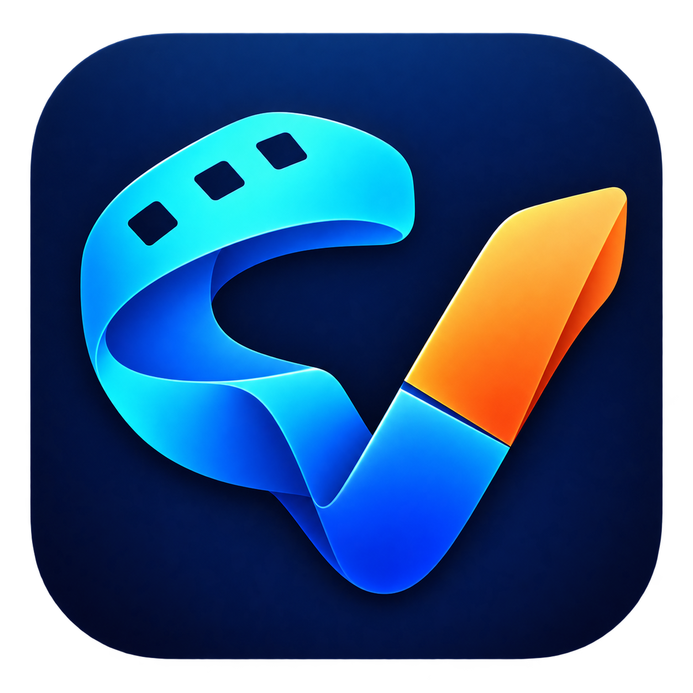

# CutVoke 应用图标

CutVoke 使用胶片折带组成的 **CV** 标志：蓝青色胶片形成 C，底部折叠形成 V，右侧橙色切面强调剪辑。该版本于 2026 年 10 月 21 日选定。



## 正式资源

| 资源 | 用途 |
| --- | --- |
| [原始 PNG](cutvoke-icon-master.png) | 1254 × 1254，保留圆角外透明区域，作为唯一图形母版 |
| [Windows ICO](../../../desktop/assets/brand/cutvoke.ico) | 16、24、32、48、64、128、256 像素，供应用、安装器和快捷方式使用 |
| [桌面 PNG](../../../desktop/assets/brand/icon-256.png) | 256 像素，供桌面窗口与 Linux 打包使用 |
| [macOS ICNS](../../../desktop/assets/brand/cutvoke.icns) | macOS 应用图标 |
| [网页资源](../../../web/app/public/brand/) | 首页、编辑器工具栏、浏览器标签页和设备快捷方式 |
| [资源清单](manifest.json) | 母版与导出文件的 SHA-256 校验值 |
| [生成提示词](generation-prompt.json) | 内置 imagegen 生成记录 |

## 使用方式

保持图标比例、蓝青与橙色配色及透明外角。小尺寸界面使用已导出的 PNG 或 ICO；不要拉伸、叠加文字或重新加入默认播放三角标志。产品名仍为 **CutVoke**。

更新母版后，在安装了 Pillow 的项目 Python 环境中运行：

```bash
python scripts/assets/build_brand_icons.py
python scripts/assets/build_brand_icons.py --check
```

脚本从同一母版导出所有尺寸，并更新中英文 README 共用横幅中嵌入的图标。桌面重建顺序为 Web 构建、引擎冻结、安装包构建，确保安装包包含最新网页资源。macOS 和 Linux 图标资源与配置已提供；对应平台的实际显示需在目标系统上验证。

## English

The approved CutVoke icon combines a cyan and blue film ribbon forming **C** with a folded **V** and an orange cut face. Keep the original proportions, colors and transparent outer corners. Use the PNG master above and the generated platform assets; regenerate them with `scripts/assets/build_brand_icons.py` rather than editing each size separately. The application, installer, Web interface and bilingual README banner share this artwork. Platform assets and configuration alone do not establish native macOS or Linux display verification.
