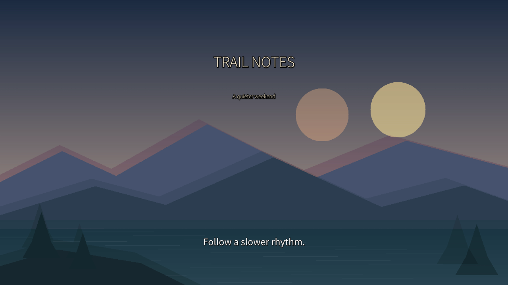

# Soft Reveal / 柔和揭幕

Names and descriptions include all supported interface locales. They have not received native-speaker review. Missing locale metadata falls back to English; the effect ID and rendering parameters stay the same. 名称与说明已包含全部界面语言，尚未经母语审校；缺失语言回退英语，效果 ID 与渲染参数不变。

A restrained dissolve for calm travel, portfolio and product edits. This is a configuration of FFmpeg's existing `fade` transition, provided as a runnable contribution template.



| Field | Value |
| --- | --- |
| ID | `cutvoke.transition.community.soft-reveal` |
| Version / author / license | `1.0.0` / CutVoke contributors / [MIT](LICENSE) |
| Engine | Existing `ffmpeg-xfade` bridge, `xfade` filter, `fade` algorithm |
| Inputs / output | Two adjacent image/video clips on a video track / composited video |
| Parameter | `duration`, seconds, 0.1–1.5, default 0.6; not animatable |
| Compatibility evidence | Windows 11, Python 3.12, FFmpeg 9.0.1; other builds require verification |
| Preview provenance | A real composited frame from the included demo's original procedural illustrations; MIT, no third-party media |

From the checkout's activated Python environment:

```bash
python scripts/verify/validate_effect_contributions.py
python -m pytest -q tests/test_effect_contributions.py
python skills/cutvoke-editor/scripts/demo.py --output .artifacts/soft-reveal-demo --effects-dir effects/transitions --effect-id cutvoke.transition.community.soft-reveal
```

The demo uses real MCP `effect.setTransition` on each incoming clip. It checks schemas, parameter validation through the service, preflight, six rendered frames, continuous preview, actual MP4 export/full decode, audio peaks/fades, and editable packaging. Watch the transitions around 4s and 8s in `trail-notes.mp4`; compare the neighboring rendered frames. The PNG alone does not demonstrate motion.

To load the manifest in the human editor, set `CUTVOKE_EFFECTS_PATH` to the absolute checkout's `effects/transitions` directory before starting `cutvoke serve` with the demo's data directory. The registry is loaded once per process; restart after changes. See [the contribution guide](../../README.md) for PowerShell/POSIX commands and PR requirements.

The implementation is entirely declared in [manifest.json](manifest.json); there is no external code module. `preview.png` is review material, not an automatically installed gallery card. The manifest's version/author/compatibility fields do not create a distribution service or version enforcement. Keep this example's known algorithm while learning; introducing a new renderer needs an implementation PR and actual media tests.
