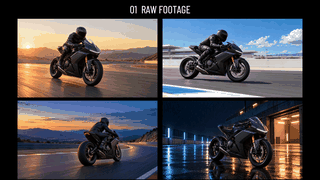

# CHASE THE LIGHT · motorcycle film

**English** · [简体中文](README.zh-CN.md)

Four 8-second MiniMax direct outputs become a 22.333-second cinematic film. All timeline editing, compositing, tracking, typography, sound and export use CutVoke.

## Preview and download the English version

<a href="https://raw.gitcode.com/shansjl/CutVoke/blobs/be0897f4fed7fe6869d188c7e54bbfad1e19afcd/examples/showcases/chase-the-light/videos/motorcycle-case_en.mp4"></a>

[Download the English comparison with sound](https://raw.gitcode.com/shansjl/CutVoke/blobs/be0897f4fed7fe6869d188c7e54bbfad1e19afcd/examples/showcases/chase-the-light/videos/motorcycle-case_en.mp4) · [Open the repository video page](videos/motorcycle-case_en.mp4)

The animation is a silent preview. Download the MP4 above for the complete source-to-edit comparison with sound.

| File | Purpose |
| --- | --- |
| [English comparison](videos/motorcycle-case_en.mp4) | Original footage followed by the CutVoke edit |
| [English clean film](videos/motorcycle-film_en.mp4) | Finished film with English on-screen text |
| [English full edit](projects/motorcycle-edit_en.cutvokepack) | Portable editable timeline and all required media |
| [English comparison project](projects/motorcycle-case_en.cutvokepack) | Editable source grid and chapter card |

The comparison uses an 8-second source grid, a 1.25-second chapter card and the complete film. Open the **full edit** package to change individual masks, fragment reconstruction, alpha passes, tracked light anchors and title clips. The comparison package contains the rendered film as its second segment.

## Chinese version

[Chinese comparison](videos/motorcycle-case_zh-CN.mp4) · [Chinese film](videos/motorcycle-film_zh-CN.mp4) · [Chinese full edit](projects/motorcycle-edit_zh-CN.cutvokepack) · [中文说明](README.zh-CN.md)

The Chinese version translates titles, dialogue/callouts, annotations and text masks, uses bundled Chinese-capable fonts, and retains the CutVoke brand name. File names and project names distinguish the two languages.

## Original media and opening the project

- [source-media/](source-media/) exposes the original source clips and supporting images, audio and alpha passes. [index.json](source-media/index.json) records exact hashes and package member mappings. The same source media serves both languages.
- Every `.cutvokepack` also embeds its required media and LUTs. In the latest source build of CutVoke, use **Unpack and open** on the home screen. Original workstation paths are relinked on import; you do not need the original data directory.

Large media and project archives use Git LFS:

```bash
git lfs install
git lfs pull --include="examples/showcases/chase-the-light/**"
```

Use the latest repository source build for the added travel effects and production archives. Previously released binaries may predate these capabilities.

## Verification and provenance

[bilingual-manifest.json](bilingual-manifest.json) pins delivered file bytes and hashes. [verification/](verification/) records full MP4 decode, duration/frame counts, sample peaks and sampled exported pictures. Package CRCs, embedded-media hashes, language coverage and standalone source hashes are verified by `tools/verify/verify_bilingual_showcases.py`. The video links use the exact MP4s in this repository's GitCode LFS storage; [gitcode-players.json](verification/gitcode-players.json) records their pinned URLs and SHA-256 hashes. All MP4 editing and export use CutVoke.

The media and user-supplied music are separate from the software MIT license. Inclusion does not grant additional music or model rights. Existing bundled font licenses remain under `src/cutvoke/assets/fonts/`.

The earlier [production-materials.zip](production-materials.zip) retains the screenshot time-lapse, native editing records and alpha-pass evidence. Legacy `source-and-edit.*` and `spectral-v7.*` files remain for existing links; the explicitly named bilingual files above are the current entry points.
