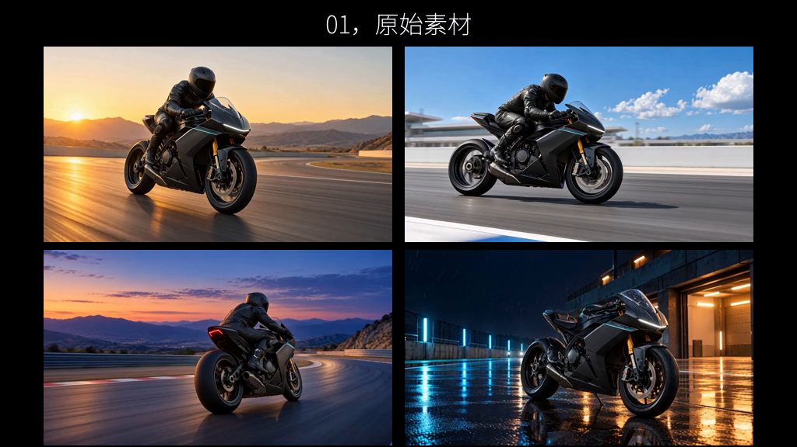

# CHASE THE LIGHT · CutVoke showcase

This example keeps the source-to-edit comparison, the approved cinematic edit,
portable editable projects, and production materials together in the repository.
All timeline editing, compositing, title animation, mixing and export were done
in CutVoke. Source video uses four 8-second MiniMax direct outputs, without AI
upscaling or frame interpolation.

## Watch and edit

| File | Purpose |
| --- | --- |
| [source-and-edit.mp4](source-and-edit.mp4) | Final 31.583-second comparison |
| [source-and-edit.cvkpkg](source-and-edit.cvkpkg) | Editable comparison timeline, including its source media |
| [spectral-v7.mp4](spectral-v7.mp4) | Approved 22.333-second cinematic edit |
| [spectral-v7.cvkpkg](spectral-v7.cvkpkg) | Full editable V7 effect stack and original media |
| [production-materials.zip](production-materials.zip) | Screenshots, native edit history, project milestones, alpha passes and a screenshot time-lapse |

These five binaries use Git LFS. Install Git LFS and run `git lfs pull` after
cloning. In CutVoke, use **Unpack and open / 解包打开** on either `.cvkpkg`.
The packages are self-contained; original workstation paths are not required.
Double-click `play-comparison.cmd` on Windows to play the final comparison.

The comparison timeline uses the approved V7 movie as its second segment.
Open `spectral-v7.cvkpkg` to edit the individual masks, text, light and VFX layers.

## 分段内容

- **00:00–00:08**：四段原始素材同步四宫格展示，静音；标题“01，原始素材”。
- **00:08–00:09.25**：静音分段卡“02，cutvoke剪辑后效果”。
- **00:09.25–00:31.583**：完整播放已认可的 V7 成片，保留其原配乐与音效。

V7 uses 21 English text clips with Barlow Condensed, Cormorant Garamond,
IBM Plex Mono and Space Grotesk. Subject mattes, fragment reconstruction,
tracked light-source anchors, optical layers and title motion remain editable
in its full project. The engine implementation and font licenses are in `src/`;
see [cinematic compositing](../../../docs/cinematic-vfx.md),
[moving masks](../../../docs/moving-masks.md), and
[title motion](../../../docs/title-motion.md).

## Production evidence

The production archive contains actual editor screenshots and a chronological
**screenshot time-lapse**, not a continuous screen recording of all revisions.
Its three ProRes 4444 passes have verified alpha channels. Native commands,
revision history and project snapshots preserve the editing process for later
CutVoke promotional material. Earlier local diagnostics are retained in the
archive and should not be presented as final movie frames.

`manifest.json` records exact delivered bytes and SHA-256 values.
`verification/` preserves decode, silence, V7 comparison, alpha and package
integrity results. The comparison decodes to 758 frames; its first 9.2 seconds
measure zero audio peak. The approved V7 source is unchanged, and the final
comparison's second segment is checked against it after native export.

These are demonstration assets and user-supplied music, separate from the
software's MIT license; inclusion does not grant additional music/model rights.
Packaged font licenses are retained alongside the font files in `src/`.
