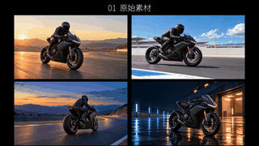

# 逐光而行 · 摩托短片

[English](README.md) · **简体中文**

四段各 8 秒的 MiniMax 直出素材，剪成 22.333 秒电影感短片。时间线剪辑、合成、跟踪、文字、声音和导出全部使用 CutVoke。

## 预览与下载中文版本

<a href="https://raw.gitcode.com/shansjl/CutVoke/blobs/d7c695df7edf271d4964701c6dd297e1e2b1ec05/examples/showcases/chase-the-light/videos/motorcycle-case_zh-CN.mp4"></a>

[下载带声音的中文对比片](https://raw.gitcode.com/shansjl/CutVoke/blobs/d7c695df7edf271d4964701c6dd297e1e2b1ec05/examples/showcases/chase-the-light/videos/motorcycle-case_zh-CN.mp4) · [打开仓库视频页](videos/motorcycle-case_zh-CN.mp4)

动图为无声预览；下载上方 MP4，可观看带声音的完整原素材与剪辑效果对比片。

| 文件 | 用途 |
| --- | --- |
| [中文对比片](videos/motorcycle-case_zh-CN.mp4) | 先看原始素材，再看 CutVoke 剪辑效果 |
| [中文纯成片](videos/motorcycle-film_zh-CN.mp4) | 画面文字中文化，保留 CutVoke 品牌名 |
| [中文完整剪辑工程](projects/motorcycle-edit_zh-CN.cutvokepack) | 可继续编辑的时间线与所需素材 |
| [中文对比工程](projects/motorcycle-case_zh-CN.cutvokepack) | 可编辑原始四宫格与分段标题 |

对比片先展示 8 秒原始四宫格，再展示 1.25 秒分段卡和完整成片。修改独立遮罩、碎片重构、透明通道素材、光源锚点或标题，请打开**完整剪辑工程**；对比工程第二段使用已导出的成片。

## 英文版本

[英文对比片](videos/motorcycle-case_en.mp4) · [英文纯成片](videos/motorcycle-film_en.mp4) · [英文完整工程](projects/motorcycle-edit_en.cutvokepack) · [English guide](README.md)

两个语言版本分别命名；中文版本同步翻译标题、对话或花字、能力说明和文字遮罩，并使用支持中文的内置字体。

## 素材与打开方式

- [source-media/](source-media/) 提供实际使用的原始片段和配套图片、声音、透明通道素材。[index.json](source-media/index.json) 记录精确哈希及工程包内路径；中英文共用这些源素材。
- 每个 `.cutvokepack` 还会内嵌自身所需素材及 LUT。在 CutVoke 最新源码版首页使用「解包打开」，导入时会重新定位素材，不依赖原工作站目录。

大体积媒体与工程使用 Git LFS：

```bash
git lfs install
git lfs pull --include="examples/showcases/chase-the-light/**"
```

请使用最新仓库源码构建，旧版发行包可能早于新增旅拍效果和生产工程包功能。

## 验证与素材说明

[bilingual-manifest.json](bilingual-manifest.json) 记录交付文件大小与 SHA-256。[verification/](verification/) 保存完整解码、时长与帧数、采样峰值和实际导出画面记录。`tools/verify/verify_bilingual_showcases.py` 检查工程包 CRC、包内素材哈希、语言覆盖及独立素材哈希。视频链接使用本仓库 GitCode LFS 存储中的原始 MP4；[gitcode-players.json](verification/gitcode-players.json) 记录固定网址与 SHA-256。全部 MP4 剪辑和导出使用 CutVoke。

示例媒体和用户提供的配乐不属于软件 MIT 许可证的授权范围；纳入仓库不额外授予音乐或模型使用权。已有字体许可证保留在 `src/cutvoke/assets/fonts/`。

早期的 [production-materials.zip](production-materials.zip) 保留截图延时记录、原生命令记录和透明通道验证。旧版 `source-and-edit.*` 与 `spectral-v7.*` 为兼容已有链接而保留；本页带语言后缀的文件是当前中英文入口。
