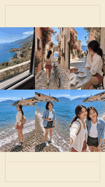

# Coastal Joy · handheld travel vlog

**English** · [简体中文](README.zh-CN.md)

A cheerful 1080×1920, 24 fps travel story about two companions, a failed seaside pose and a shared laugh. Six MiniMax source clips retain their handheld camera movement and environmental audio. All editing and MP4 export use CutVoke.

## Watch the English version

[](https://media.githubusercontent.com/media/frankShan001/CutVoke/main/examples/showcases/travel-vlog/videos/travel-vlog-case_en.mp4)

The animation previews the complete native comparison timeline without sound. Click it to download the MP4 with audio.

| File | Purpose |
| --- | --- |
| [English comparison](videos/travel-vlog-case_en.mp4) | Original footage followed by the CutVoke edit |
| [English clean film](videos/travel-vlog-film_en.mp4) | Finished film with English on-screen text |
| [English full edit](projects/travel-vlog_en.cutvokepack) | Portable editable timeline and all required media |

The 42.5-second comparison starts with a 4-second raw grid, then the 38.5-second edit with capability annotations. The clean film starts at timeline second 4 with the annotation track hidden. The package retains all video, audio, title, sticker, mask, keyframe and color layers. Background blur is whole-layer blur plus a clear rectangular inset, not person segmentation.

## Chinese version

[Chinese comparison](videos/travel-vlog-case_zh-CN.mp4) · [Chinese film](videos/travel-vlog-film_zh-CN.mp4) · [Chinese full edit](projects/travel-vlog_zh-CN.cutvokepack) · [中文说明](README.zh-CN.md)

The Chinese version translates titles, dialogue/callouts, annotations and text masks, uses bundled Chinese-capable fonts, and retains the CutVoke brand name. File names and project names distinguish the two languages.

## Original media and opening the project

- [source-media/](source-media/) exposes the original source clips and supporting images, audio and alpha passes. [index.json](source-media/index.json) records exact hashes and package member mappings. The same source media serves both languages.
- Every `.cutvokepack` also embeds its required media and LUTs. In the latest source build of CutVoke, use **Unpack and open** on the home screen. Original workstation paths are relinked on import; you do not need the original data directory.
- For the clean travel film, hide the capability-annotation track and export timeline range 4–42.5 seconds. This instruction applies only to the travel example.

Large media and project archives use Git LFS:

```bash
git lfs install
git lfs pull --include="examples/showcases/travel-vlog/**"
```

Use the latest repository source build for the added travel effects and production archives. Previously released binaries may predate these capabilities.

## Verification and provenance

[bilingual-manifest.json](bilingual-manifest.json) pins delivered file bytes and hashes. [verification/](verification/) records full MP4 decode, duration/frame counts, sample peaks and sampled exported pictures. Package CRCs, embedded-media hashes, language coverage and standalone source hashes are verified by `scripts/verify/verify_bilingual_showcases.py`. The silent GIFs are scaled documentation conversions of complete CutVoke exports; no alternative video editor produced the MP4s.

The media and user-supplied music are separate from the software MIT license. Inclusion does not grant additional music or model rights. Existing bundled font licenses remain under `src/cutvoke/assets/fonts/`.
