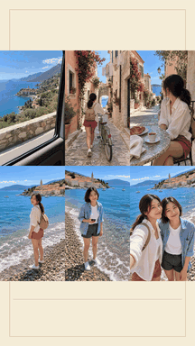

# 海岸快乐日记 · 手持旅拍 Vlog

[English](README.md) · **简体中文**

1080×1920、24 帧的轻松旅伴日记：海浪打断摆拍，摄影师先笑场，两个人一起留下回忆。六段 MiniMax 素材保留手持感和环境声，全部剪辑及 MP4 导出使用 CutVoke。

## 观看中文版本

[](https://media.githubusercontent.com/media/frankShan001/CutVoke/main/examples/showcases/travel-vlog/videos/travel-vlog-case_zh-CN.mp4)

动图完整预览原素材与剪辑效果时间线，不含声音。点击画面可打开带声音的完整 MP4。

| 文件 | 用途 |
| --- | --- |
| [中文对比片](videos/travel-vlog-case_zh-CN.mp4) | 先看原始素材，再看 CutVoke 剪辑效果 |
| [中文纯成片](videos/travel-vlog-film_zh-CN.mp4) | 画面文字中文化，保留 CutVoke 品牌名 |
| [中文完整剪辑工程](projects/travel-vlog_zh-CN.cutvokepack) | 可继续编辑的时间线与所需素材 |

42.5 秒对比片先播放 4 秒原始六宫格，再播放 38.5 秒剪辑效果并显示能力说明。纯成片从时间线第 4 秒开始，隐藏能力说明轨。工程保留视频、声音、文字、贴纸、遮罩、关键帧和调色图层。背景模糊使用整层模糊加清晰矩形画中画，不是人物分割。

## 英文版本

[英文对比片](videos/travel-vlog-case_en.mp4) · [英文纯成片](videos/travel-vlog-film_en.mp4) · [英文完整工程](projects/travel-vlog_en.cutvokepack) · [English guide](README.md)

两个语言版本分别命名；中文版本同步翻译标题、对话或花字、能力说明和文字遮罩，并使用支持中文的内置字体。

## 素材与打开方式

- [source-media/](source-media/) 提供实际使用的原始片段和配套图片、声音、透明通道素材。[index.json](source-media/index.json) 记录精确哈希及工程包内路径；中英文共用这些源素材。
- 每个 `.cutvokepack` 还会内嵌自身所需素材及 LUT。在 CutVoke 最新源码版首页使用「解包打开」，导入时会重新定位素材，不依赖原工作站目录。
- 旅拍纯成片的重导出方式：隐藏能力说明轨，导出第 4–42.5 秒区间。这条仅适用于旅拍案例。

大体积媒体与工程使用 Git LFS：

```bash
git lfs install
git lfs pull --include="examples/showcases/travel-vlog/**"
```

请使用最新仓库源码构建，旧版发行包可能早于新增旅拍效果和生产工程包功能。

## 验证与素材说明

[bilingual-manifest.json](bilingual-manifest.json) 记录交付文件大小与 SHA-256。[verification/](verification/) 保存完整解码、时长与帧数、采样峰值和实际导出画面记录。`scripts/verify/verify_bilingual_showcases.py` 检查工程包 CRC、包内素材哈希、语言覆盖及独立素材哈希。静音动图由完整 CutVoke 成片缩小转换，仅用于文档预览；MP4 没有使用其他剪辑器制作。

示例媒体和用户提供的配乐不属于软件 MIT 许可证的授权范围；纳入仓库不额外授予音乐或模型使用权。已有字体许可证保留在 `src/cutvoke/assets/fonts/`。
